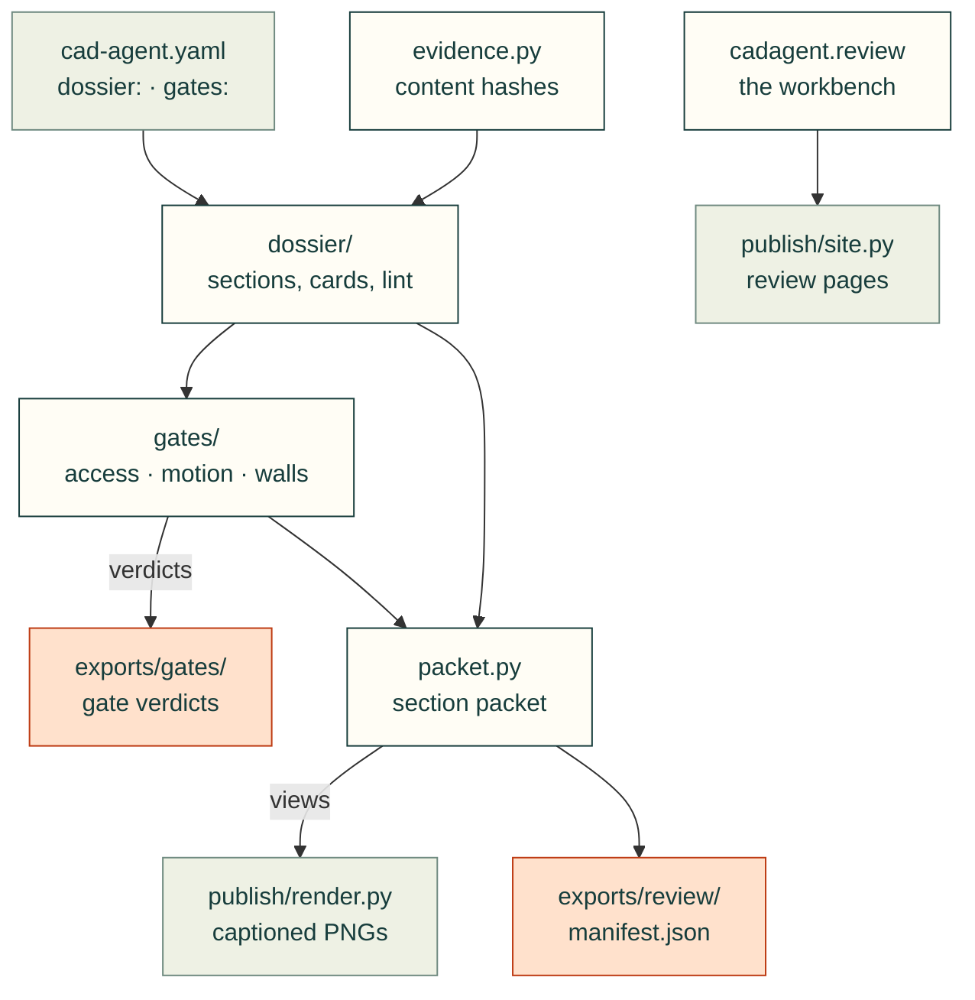

# cadagent.review

The practice domain's design-process and review-and-evidence areas of the [topic tree](../../../docs/areas.yaml):
the design dossier, the integrity gates that check an assembly against it, the section packets a reviewer reads, and
the hashes that tell current evidence from stale. `from cadagent.review import review_html` is the in-page review
workbench, as it was before this folder existed.

Arrows follow the data. Each arrow between pieces here is also an import, and `dossier/` imports `gates/` back to
lint the verdicts it reads. `packet.py` asks `publish/render.py` for its views; `publish/site.py` imports the
workbench.

| Module | What it does |
|---|---|
| `__init__.py` | The in-page review workbench for PCBs, housings and assemblies (`review_html`) |
| [`dossier/`](dossier/__init__.py) | The design dossier: requirements, sections, spec cards, interfaces, decisions, and its lint (`cad-agent dossier`) |
| [`gates/`](gates/__init__.py) | Assembly integrity gates (access order, connectivity, containment, fasteners, motion, walls), each written as a verdict (`cad-agent gates`) |
| `packet.py` | The section review packet: captioned renders with the measurements first (`cad-agent review-packet`) |
| `evidence.py` | Shared integrity screen for source-bound CAD and PCB records: content hashes and whether a record is current |

Related: [package map](../README.md) · [publish](../publish/README.md) (the review pages) ·
[design process](../../../docs/design-process-plan.md) · [gates](../../../docs/gates.md) ·
[dossier](../../../docs/dossier.md) · [review packet](../../../docs/review-packet.md)
