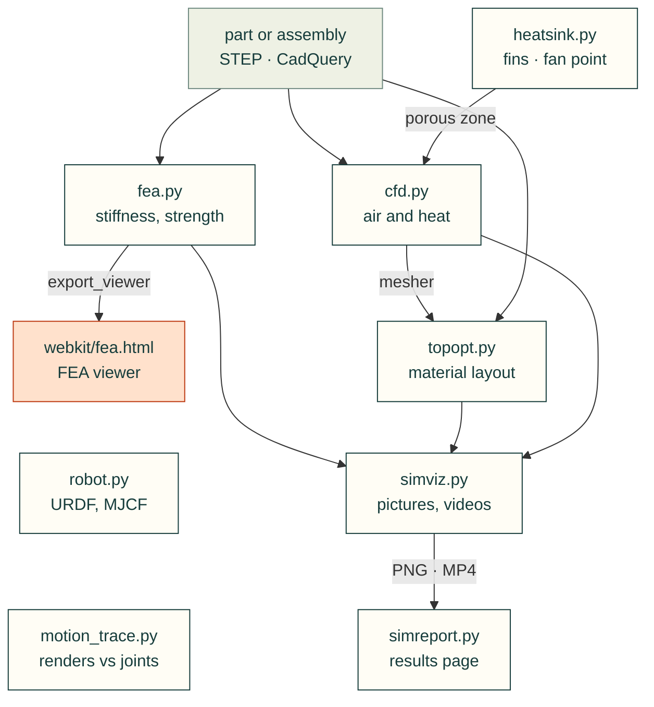

# cadagent.sim

Simulation and what it produces: stiffness and strength, airflow and heat, optimised material layouts, robot
descriptions, and the pictures and pages that show the results honestly (assumptions and limits included).

Arrows follow the data. Only `topopt.py` imports its neighbours (`cfd.py`'s mesher and `simviz.py`'s drawing
helpers); the other arrows are objects and files that a project's script passes on. `robot.py` and `motion_trace.py`
stand alone.

| Module | What it does |
|---|---|
| `fea.py` | Linear-elastic stiffness and strength studies for any CAD part; exports the interactive FEA viewer's data |
| `cfd.py` | Steady conjugate heat transfer cases for OpenFOAM, written from CAD |
| `heatsink.py` | Plate-fin heat sinks: thermal resistance, pressure drop, fan operating point, porous-zone coefficients |
| `topopt.py` | Topology optimisation with [pyMOTO](https://github.com/aatmdelissen/pyMOTO) (Arnoud Delissen, MIT) |
| `robot.py` | Mass properties from CAD, links and joints, URDF writing and checking |
| `motion_trace.py` | Compares rendered landmarks with CAD joint intent, without a CAD kernel |
| `simviz.py` | Pictures and animations of results with [PyVista](https://github.com/pyvista/pyvista) / VTK, off screen |
| `simreport.py` | A standalone HTML page: before/after metrics, figures, videos, limits |

Related: [package map](../README.md) · [simulation tools research](../../../research/simulation-tools.md) ·
[lesson: simulation and material](../../../lessons/10-simulation-and-material.md)
