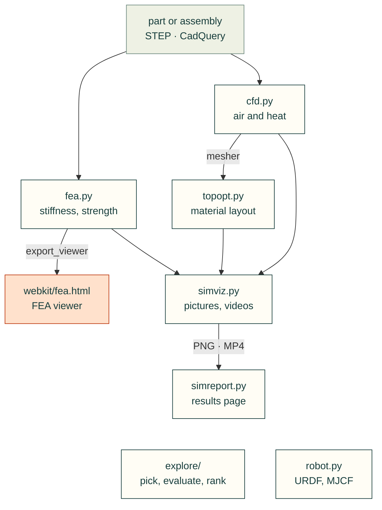

# cadagent.simulation

The simulation domain of the [topic tree](../../../docs/areas.yaml): predicting how designs behave (stiffness and
strength, airflow and heat, optimised material layouts, robot descriptions, whole designs compared), and the pictures
and pages that show the results honestly, assumptions and limits included.

Arrows follow the data. Only `topopt.py` imports its neighbours (`cfd.py`'s mesher and `simviz.py`'s drawing
helpers); the other arrows are objects and files that a project's script passes on. `explore/` and `robot.py` stand
alone.

| Module | What it does |
|---|---|
| `fea.py` | Linear-elastic stiffness and strength studies for any CAD part; exports the interactive FEA viewer's data |
| `cfd.py` | Steady conjugate heat transfer cases for OpenFOAM, written from CAD |
| `topopt.py` | Topology optimisation with [pyMOTO](https://github.com/aatmdelissen/pyMOTO) (Arnoud Delissen, MIT) |
| `robot.py` | Mass properties from CAD, links and joints, URDF writing and checking |
| [`explore/`](explore/__init__.py) | Pick parts from catalogues, evaluate whole designs, rank the trade-offs (`cad-agent catalogue`, `compare`, `optimise`) |
| `simviz.py` | Pictures and animations of results with [PyVista](https://github.com/pyvista/pyvista) / VTK, off screen |
| `simreport.py` | A standalone HTML page: before/after metrics, figures, videos, limits |

Related: [package map](../README.md) · [thermal](../thermal/README.md) (heat sinks) ·
[simulation tools research](../../../research/simulation-tools.md) ·
[lesson: simulation and material](../../../lessons/simulation/simulation-and-material.md)
