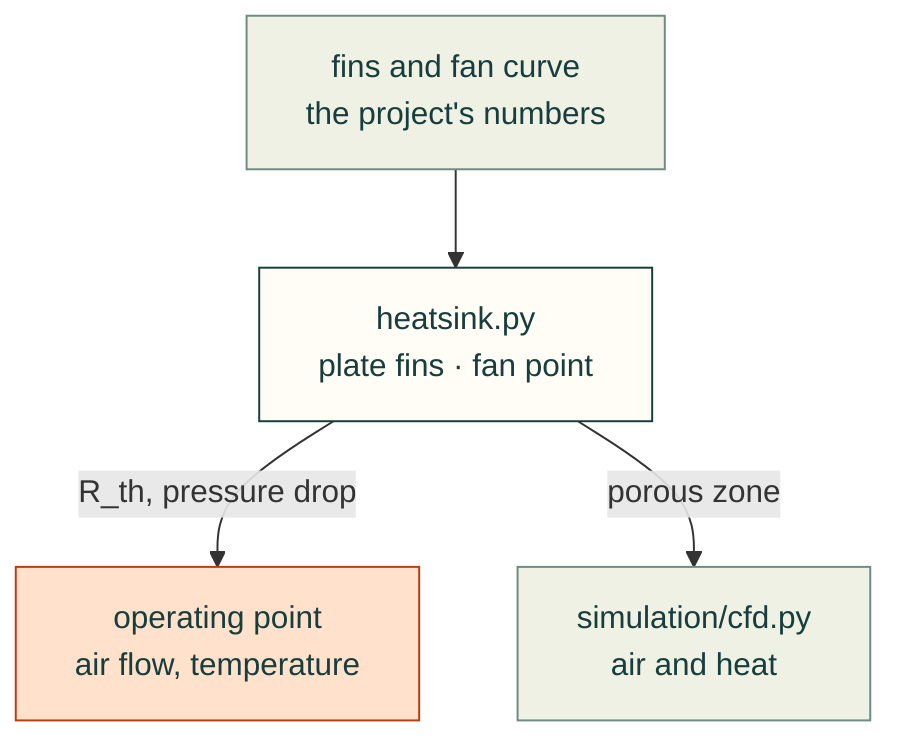

# cadagent.thermal

The thermal domain of the [topic tree](../../../docs/areas.yaml): keeping parts and electronics within their
temperature limits. Airflow and conjugate heat transfer are simulations, so `cfd.py` lives in
[`simulation/`](../simulation/README.md).

Arrows follow the data. `heatsink.py` imports nothing from cad-agent; its porous-zone coefficients reach
`simulation/cfd.py` through a project's script.

| Module | What it does |
|---|---|
| `heatsink.py` | Plate-fin heat sinks: thermal resistance, pressure drop, fan operating point, porous-zone coefficients |

Related: [package map](../README.md) · [simulation](../simulation/README.md) ·
[toolkit: heatsinks](../../../docs/toolkit.md#heatsinks-cadagentthermalheatsink)
