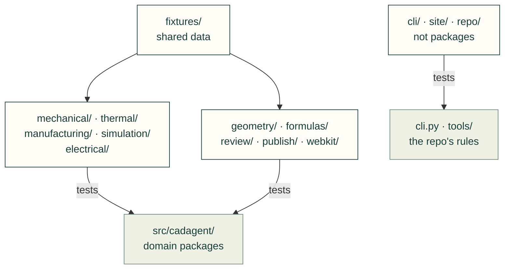

# tests

cad-agent's tests, one folder per package of [`src/cadagent/`](../src/cadagent/README.md), plus three areas that are
not packages and the shared fixtures. A test goes in the folder of the package its main subject lives in, whatever
else it imports. [`repo/test_layout.py`](repo/test_layout.py) refuses a test file directly in `tests/` and says
which folder it belongs in.

Arrows: which code each group of folders tests.



## What's here

| Folder or file | What it tests |
|---|---|
| [`cli/`](cli/README.md) | `cli.py` and the modules beside it at the top of the package: the project file, links, the agent kit, lazy dependencies, the version |
| [`electrical/`](electrical/README.md) | `cadagent.electrical`: PCB evidence, routed boards |
| [`formulas/`](formulas/README.md) | `cadagent.formulas`: closed forms against worked examples and derivations |
| [`geometry/`](geometry/README.md) | `cadagent.geometry`: CAD helpers, reproducible STEP |
| [`manufacturing/`](manufacturing/README.md) | `cadagent.manufacturing`: 3MF, build plates, slicer numbers, fit coupons, process profiles |
| [`mechanical/`](mechanical/README.md) | `cadagent.mechanical`: holes, fasteners, connectors, inserts, compliant features, linkages, motion |
| [`publish/`](publish/README.md) | `cadagent.publish`: results, reports, renders, views, a project's site, the release, animated figures |
| [`repo/`](repo/README.md) | The repository's own rules and tooling: the topic tree, where files go, skills, the gates, releases, the supply-chain audit |
| [`review/`](review/README.md) | `cadagent.review`: the dossier, the integrity gates, review packets, evidence hashes |
| [`simulation/`](simulation/README.md) | `cadagent.simulation`: FEA, CFD, topology optimisation, robot export; design exploration in `simulation/explore/` |
| [`site/`](site/README.md) | cad-agent's own website and its build (`tools/build-site.mjs`, `tools/site-*.mjs`) |
| [`thermal/`](thermal/README.md) | `cadagent.thermal`: heat sinks |
| [`webkit/`](webkit/README.md) | `cadagent.webkit` in Node (`*.test.mjs`) and in real browsers (`*-browser.mjs`) |
| [`fixtures/`](fixtures/README.md) | Data any test may read: the gate bench, recorded CFD runs, the formula vectors, McMaster pages, slicer templates, viewer files |
| `__init__.py` | Empty, like one in every folder here: test modules are named `tests.<folder>.<file>`, so two folders may hold files of the same name |

## Adding a test

- **Which folder:** the package of the code under test (`cadagent.review.gates` → `review/`). For a test of a
  `tools/` script, the package whose output the script draws or checks (`tools/motion_figures.py` → `mechanical/`),
  or `repo/` for the repo's own tooling and `site/` for the site build. A new folder is a new package or area: add it
  to `AREAS` in `repo/test_layout.py` and to this table, with its README and `__init__.py`.
- **Paths:** a test file is two folders below the repo root: `ROOT = Path(__file__).resolve().parents[2]`, and the
  shared fixtures are `Path(__file__).resolve().parents[1] / "fixtures"`. In Node, `path.resolve(import.meta.dirname,
  '../..')`.
- **Helpers** shared within a folder live in it (`simulation/cfd_fixtures.py`); import them relatively
  (`from .cfd_fixtures import recorded`), or as `tests.<folder>.<module>` from another folder.
- **When a folder grows** past 20 files, split it into subfolders named after the subpackages, each with a README
  and `__init__.py`, as `simulation/explore/` mirrors `src/cadagent/simulation/explore/` (the growth rule in
  [AGENTS.md](../AGENTS.md#repo-structure-and-where-files-go)). A test file there is three folders below the root.

## Running them

```bash
PYTHONPATH=src python -m pytest -q                    # everything Python; or one folder: pytest tests/review
node --test tests/webkit/*.test.mjs tests/site/website-*.test.mjs
npm run test:site && npm run test:part-table && npm run test:file-viewer && npm run test:diagrams
```

Related: [repository README](../README.md) · [CONTRIBUTING: where files go](../CONTRIBUTING.md#where-files-go) ·
[package map](../src/cadagent/README.md) · [style guide](../docs/style-guide.md)
