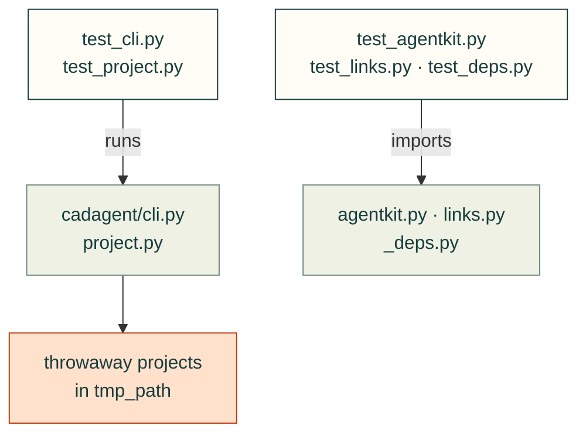

# tests/cli

Tests for `cli.py` and the modules beside it at the top of [`src/cadagent/`](../../src/cadagent/README.md): the
project file, links, the review zip, the agent kit, lazy dependencies and the version.

Arrows: what a test imports, runs or reads.

| File | What it tests |
|---|---|
| `__init__.py` | Empty: makes the folder a package, so a test here may share a file name with one in another folder |
| `test_agentkit.py` | `cad-agent agents install`: which skills and subagents land where, for Claude Code and Codex |
| `test_cli.py` | `cad-agent ...` end to end through `cadagent.cli.main`, on throwaway projects |
| `test_deps.py` | A missing heavy dependency raises `MissingDependency` naming the module, never a quiet skip |
| `test_links.py` | `cadagent.links`: local link checks for HTML and Markdown pages |
| `test_project.py` | `cadagent.project`: the `cad:` section of `cad-agent.yaml`, beside other tools' sections |
| `test_version.py` | `cadagent.__version__` from a checkout, an editable install or a wheel |

Run: `pytest tests/cli` (with `PYTHONPATH=src`).

Related: [tests](../README.md) · [where files go](../../CONTRIBUTING.md#where-files-go)
