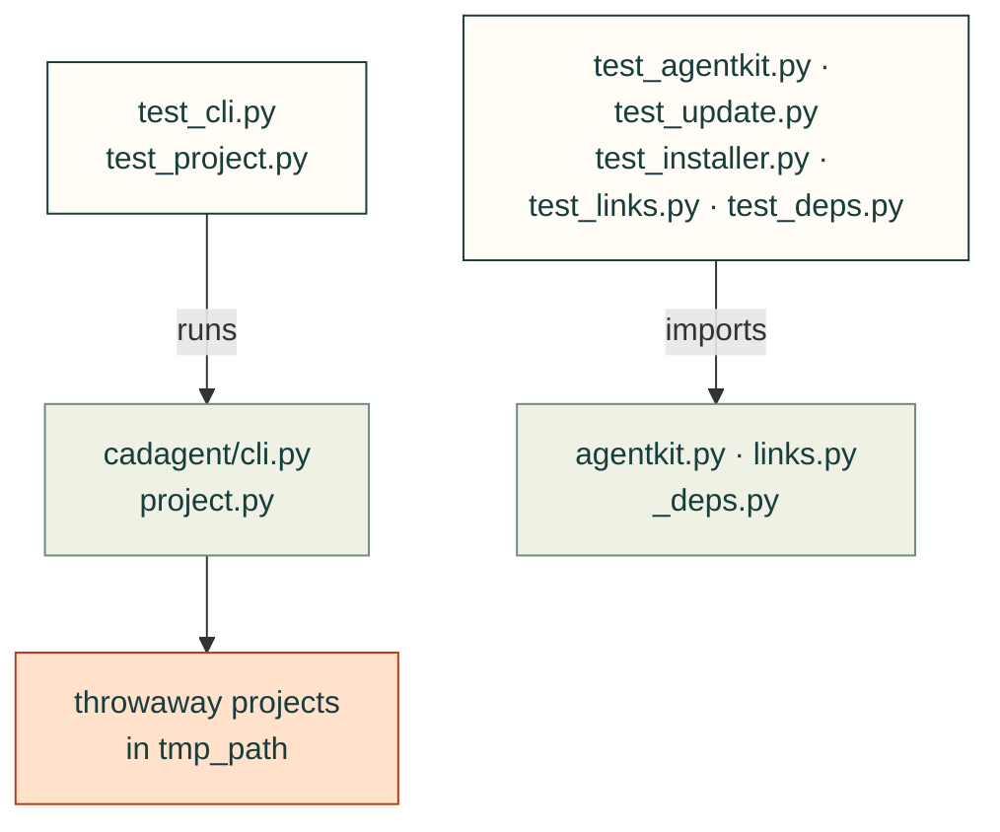

# tests/cli

Tests for `cli.py` and the modules beside it at the top of [`software/cadagent/`](../../software/cadagent/README.md): the
project file, links, the review zip, the agent kit, lazy dependencies and the version.

Arrows: what a test imports, runs or reads.

| File | What it tests |
|---|---|
| `__init__.py` | Empty: makes the folder a package, so a test here may share a file name with one in another folder |
| `test_agentkit.py` | `cad-agent agents install`: which skills and subagents land where (`~/.claude`, `~/.agents/skills`), the move off `~/.codex/skills`, pruning and uninstalling; what each needs, its Needs line, and the notice of what can't be used yet |
| `test_cli.py` | `cad-agent ...` end to end through `cadagent.cli.main`, on throwaway projects |
| `test_init.py` | Checkout starter copying and declaration parity; `python tests/cli/test_init.py --wheel-smoke` builds and installs the committed wheel outside the checkout, checks bytes, rejects missing installed starter data, and verifies SDK ESM scope under an explicit CommonJS ancestor once in full CI |
| `test_deps.py` | A missing heavy dependency raises `MissingDependency` naming the module, never a quiet skip |
| `test_installer.py` | Checked-entry guards and the real POSIX body with a stand-in uv; an explicit manual Windows study runs the canonical checked body under PowerShell 5.1/7 with real uv, exit-3/receipt handoff and an OS-denied copy fallback. Fast tests do not claim this opt-in proof. |
| `test_links.py` | `cadagent.links`: local link checks for HTML and Markdown pages |
| `test_privacy.py` | Usage reporting off: every project step runs with the opt-outs in `OPT_OUTS`, the caller's environment is untouched, and every telemetry, update-check or export switch a vendored tool names is covered |
| `test_project.py` | `cadagent.project`: the `cad:` section of `cad-agent.yaml`, beside other tools' sections |
| `test_update.py` | `cad-agent update` against a temporary git remote: fast-forward only, the refusals, `--ref` tags, a dependency change, the changelog with "Projects must change" first, project advice, staleness and `cad: cad-agent:` in `all` |
| `test_version.py` | `cadagent.__version__` from a checkout, an editable install or a wheel |

Run: `pytest tests/cli` (with `PYTHONPATH=software`).

Related: [tests](../README.md) · [where files go](../../.github/CONTRIBUTING.md#where-files-go)
