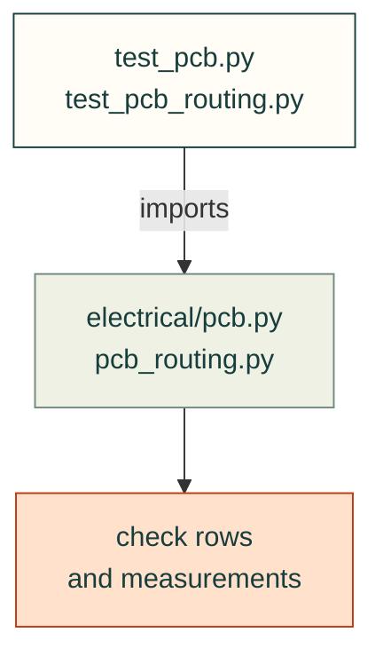

# tests/electrical

Tests for [`src/cadagent/electrical/`](../../src/cadagent/electrical/README.md): PCB evidence and routed-board
measurements.

Arrows: what a test imports, runs or reads.

| File | What it tests |
|---|---|
| `__init__.py` | Empty: makes the folder a package, so a test here may share a file name with one in another folder |
| `test_pcb.py` | `cadagent.electrical.pcb`: board evidence fails closed on missing, stale or incomplete reports |
| `test_pcb_routing.py` | `cadagent.electrical.pcb_routing`: trunk lengths, layer crossings and differential pairs |

Run: `pytest tests/electrical` (with `PYTHONPATH=src`).

Related: [tests](../README.md) · [where files go](../../CONTRIBUTING.md#where-files-go)
