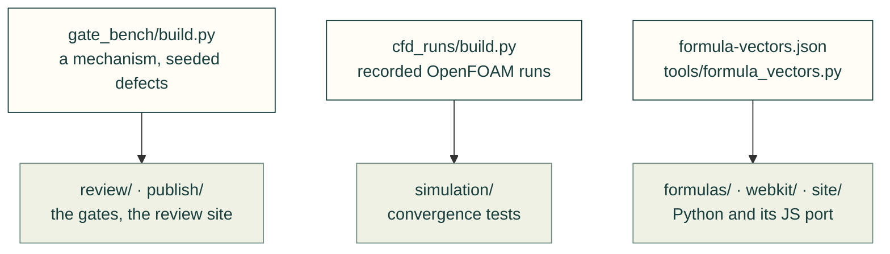

# tests/fixtures

Data the tests read, shared by every folder under [`tests/`](../README.md). Each set is written by a script beside it
or by hand, and never fetched at test time. A test reaches this folder as
`Path(__file__).resolve().parents[1] / "fixtures"`.

Arrows: who writes a set and which tests read it.

| File or folder | What it is |
|---|---|
| `bambu_templates/` | A reduced Bambu Studio P1S profile graph, for `manufacturing/test_slicer.py` ([README](bambu_templates/README.md)) |
| `cfd_runs/` | Recorded-format CFD runs, synthetic numbers in OpenFOAM's layout; rebuild with `python tests/fixtures/cfd_runs/build.py` |
| `file-viewer/` | A generated STEP block for the original-file viewer suites ([README](file-viewer/README.md)) |
| `formula-vectors.json` | Golden vectors from `cadagent.formulas`, which the browser port must match; written by `tools/formula_vectors.py` |
| `gate_bench/` | The gate bench: a small generic mechanism through the dossier registry, its seeded defects, and the review site's snapshot |
| `mcmaster/` | Hand-written McMaster-Carr pages, so the tests never fetch the site ([README](mcmaster/README.md)) |
| `model/` | The packed two-part model both model decoders are held to; rebuild with `make_fixture.py` |

Related: [tests](../README.md) · [where files go](../../CONTRIBUTING.md#where-files-go)
