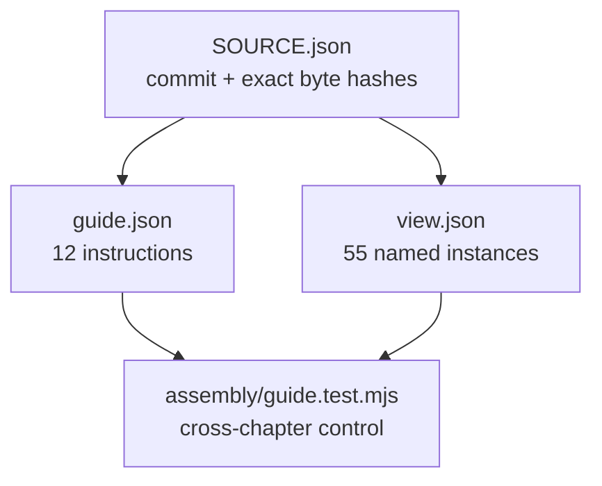

# Real guide contract fixture

Unmodified JSON from the Gyropup instruction pilot, pinned in [SOURCE.json](SOURCE.json). The twelve steps retain
previous chapters as visible context while highlighting only the current subassembly. This fixture tests schema
interoperability, not CAD freshness, mesh generation or physical qualification.

| File | Contents |
|---|---|
| `SOURCE.json` | Public source commit, paths, hashes and evidence limit |
| `guide.json` | Actual product guide, unchanged |
| `view.json` | Actual product manifest, unchanged; meshes intentionally not included |
