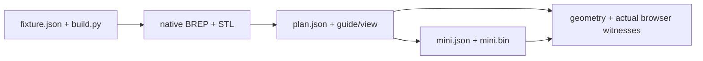

# Native serial assembly bench

One source-defined base, compound rail, plate, attached test-fastener prism and lid exercises both viewer
consumers and independent geometry/tool checks. This is a synthetic clearance fixture, not hardware design.

| Files | Owner |
|---|---|
| `fixture.json`, `build.py` | Primitive source geometry, independent rail/roof intent and ordinary test-driver dimensions. Run `PYTHONPATH=software <CAD python> tests/fixtures/assembly-plan/build.py`. |
| `base.stl`, `rail.stl`, `plate.stl`, `fastener.stl`, `lid.stl` | Native CAD tessellation in assembly-home mm; retained small browser inputs. |
| `view.json`, `plan.json`, `guide.json`, `mini.json`, `mini.bin` | Regenerated source-bound detailed and packed inputs. Both consumers reference the same `plan.json` bytes. |

`tests/review/test_gate_assembly.py` regenerates native BREP evidence in memory; no native body archive is
checked in. `tests/webkit/assembly/browser.mjs` observes actual rendered vertices against independently
specified source corners and rail/roof poses. Regenerate after source changes; generated data is never edited.
Support, retention, threaded engagement and rigid-module internal qualification remain unverified.
