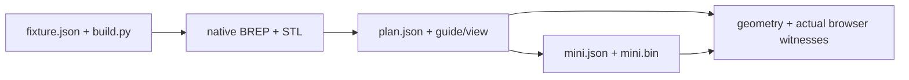

# Native serial assembly bench

One source-defined base, compound rail, plate, attached test-fastener prism and lid exercises both viewer
consumers and independent geometry/tool checks. This is a synthetic clearance fixture, not hardware design.



| Files | Owner |
|---|---|
| `fixture.json`, `build.py` | Primitive source geometry, independent rail/roof intent and ordinary test-driver dimensions. Run `PYTHONPATH=software <CAD python> tests/fixtures/assembly-plan/build.py`. |
| `base.stl`, `rail.stl`, `plate.stl`, `fastener.stl`, `lid.stl` | Native CAD tessellation in assembly-home mm; retained small browser inputs. |
| `view.json`, `plan.json`, `guide.json`, `mini.json`, `mini.bin` | Regenerated source-bound detailed and packed inputs. Both consumers reference the same `plan.json` bytes. |

`tests/review/test_gate_assembly.py` regenerates native BREP evidence in memory; no native body archive is
checked in. `tests/webkit/assembly/browser.mjs` observes actual rendered vertices against independently
specified source corners and rail/roof poses. Regenerate after source changes; generated data is never edited.
Support, retention, threaded engagement and rigid-module internal qualification remain unverified.

| Retained evidence | Scope |
|---|---|
| `acceptance.json` | Native source-bound forward/reverse summaries, actual thin/attached/tool obstruction witnesses, and both engines' actual world-vertex traces at source revision `6c5e3647`. |
| `partition-failure-9b819b9a.json` | Independently reproduced blocked-head exporter/actual-Chromium duplicate-ID acceptance; preserved failure evidence, not a passing receipt. |
| `webkit-320.png` | Actual two-mini scene at 320 px, DPR2, reduced motion, keyboard focus; not a clearance witness. |

Reproduce with the existing installed CAD Python and browser runtimes, without installing dependencies:

```sh
PYTHONPATH=software <CAD Python> -c "from tests.review.test_gate_assembly import write_serial_native_receipt; write_serial_native_receipt('/tmp/serial-native.json', '<exact source SHA>')"
ASSEMBLY_PLAN_ONLY=1 PLAYWRIGHT_BROWSER=chromium TEST_SOURCE_REVISION=<exact-source-SHA> TEST_OUTPUT=/tmp/serial-browser node tests/webkit/assembly/browser.mjs
ASSEMBLY_PLAN_ONLY=1 PLAYWRIGHT_BROWSER=webkit TEST_SOURCE_REVISION=<exact-source-SHA> TEST_OUTPUT=/tmp/serial-browser node tests/webkit/assembly/browser.mjs
```

Set `PLAYWRIGHT_BROWSERS_PATH` to an already installed matching runtime when needed. `acceptance.json` collects
these native/renderer JSON objects with their source hashes; its observations remain a frozen source snapshot,
not a substitute for current-head CI or independent review. The legacy J501 poster receipt is separate.
