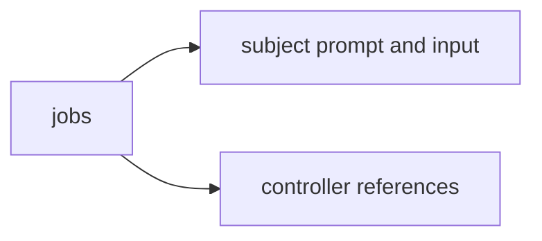

# Standard evaluation corpus

Versioned [jobs](jobs/README.md), controller-only references and deterministic grading inputs for [the evaluation controller](../../../tools/evaluation/README.md). Subject preparation copies only the task and `input.json`.

## Candidate catalog

[candidates.yaml](candidates.yaml) is the non-executable planning index: existing v1 jobs are linked, while
original candidate briefs record difficulty, inputs, success criteria, artifacts, sources and limits. It does
not qualify a grader or start a model. See [catalog contract and promotion](../../../docs/practice/standard-evaluation.md#candidate-task-catalog)
before selecting or adding a task. Never expose this whole controller index or its references to a subject.
