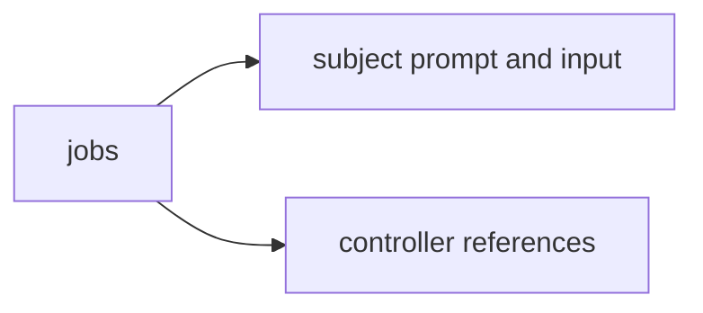

# Standard evaluation corpus

Versioned [jobs](jobs/README.md), controller-only references and deterministic grading inputs for [the evaluation controller](../../../tools/evaluation/README.md). Subject preparation copies only the task and `input.json`.

