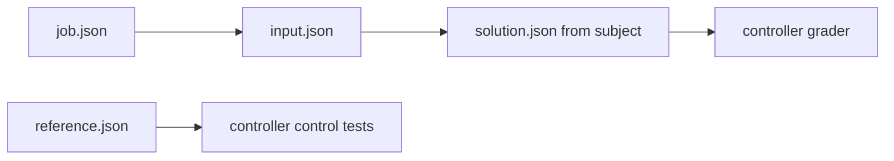

# Analytical starter jobs

Each job has a versioned `job.json`, `input.json` and controller-only `reference.json`. [Schema, grader API and limits](../../../../docs/practice/standard-evaluation.md).

| Job | Checks |
|---|---|
| [snapfit-sizing](snapfit-sizing/README.md) | Shortest permitted beam, strain, force and fillet |
| [lid-rib-clearance](lid-rib-clearance/README.md) | Rib envelopes, service clearance and movement |
| [connector-breakout](connector-breakout/README.md) | Exact connector/test-point pin graph |

