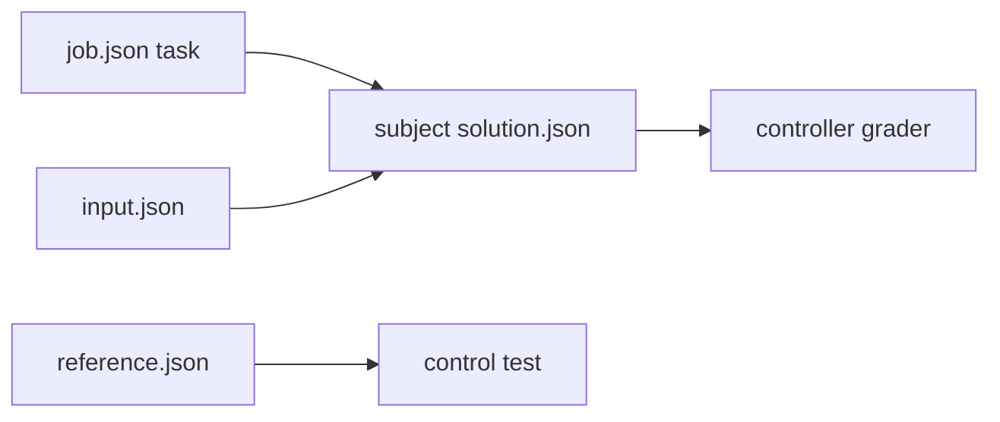

# connector-breakout

Version 1 analytical job. Read [job.json](job.json) for its task, budget and limits; [input.json](input.json) is subject-visible. [reference.json](reference.json) is a passing controller control and must never be copied into a subject workspace.

