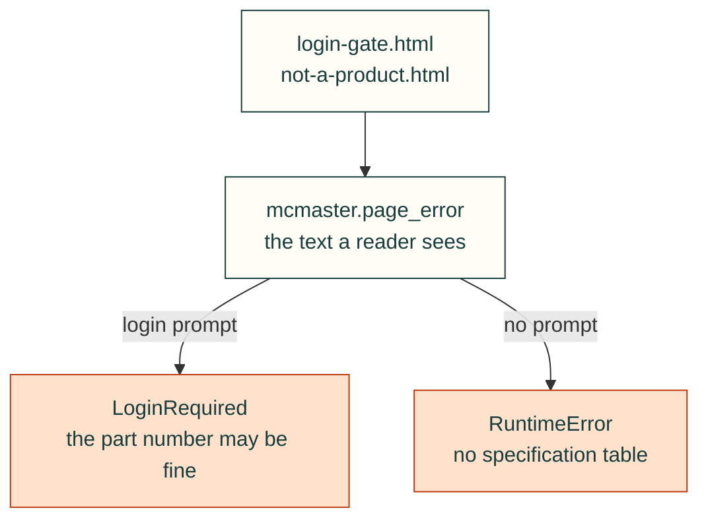

# McMaster-Carr page fixtures

Hand-written pages for `tests/mechanical/test_mcmaster.py`, so the tests never fetch McMaster-Carr. Neither page is copied
from mcmaster.com; each holds only the text the code looks for.

| File | What it is |
|---|---|
| `login-gate.html` | The prompt McMaster showed in place of a product page on 2026-10-31 ("Log in to view Product Detail"), split across tags and spaces, with a header "Log in" link and a script string |
| `not-a-product.html` | No specification table and no prompt a reader sees: the header "Log in" link, and the phrase only in a script, a hidden login dialog, `aria-hidden` and `display: none` elements and a textarea, none of which may count |
