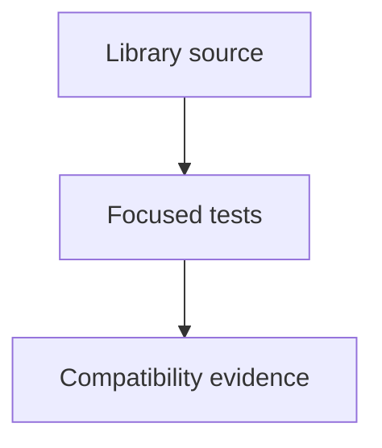

# tests/fixtures/scada

SCADA regression fixtures and tests; source packages remain independently usable.

| File or folder | Purpose |
| --- | --- |
| [default-model-inputs/](default-model-inputs/README.md) | Original inputs for live examples that have since evolved; test-only and never shipped. |
| [default-baseline.json](default-baseline.json) | Frozen default-state compatibility fixture. |

[Runtime library map](../../../software/cadagent/webkit/scada/README.md) · [Parent map](../README.md)

The baseline is the untouched original 60-scenario, 1,440-checkpoint oracle. Historical source paths inside it record provenance; they are not runtime imports or repository dependencies. New scenarios are checked by catalog/model contracts and focused tests, not silently added to this frozen expectation. Run `npm --prefix tools/webkit/scada run check:default-baseline` to compare live model behavior.
