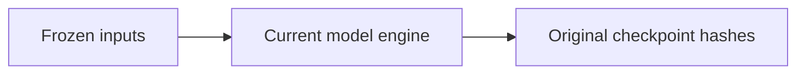

# Frozen model inputs

[Fixture map](../README.md) · [Current examples](../../../../software/cadagent/webkit/scada/sim/scenarios/README.md)

These are the original winery and brewery inputs for the unchanged 1,440-checkpoint
model regression oracle. The live examples can evolve without changing what that
oracle proves about the engine. These files are used only by tests and are never
published as a runtime scenario or compatibility entry.

The inputs were copied byte-for-byte from source at `e84f47b8e35067deda1036fd85461034118dc742`,
before the authored examples were expanded. `index.json` retains the original
experiment recipes; its system/model paths are local fixture paths. Keep the
original oracle and these inputs immutable. Current examples have their own
connected-operation tests.

| Input | SHA-256 |
| --- | --- |
| [brewery.model.json](brewery.model.json) | `23fd7a230d0ff2ffc11ab99d3b127f1fa781a328149e26cda1e4ebbd4174caec` |
| [brewery.system.json](brewery.system.json) | `688bf5df79f984f06fa0fbd522b4d34d3603aa1f3f9167dc4410580917f66c79` |
| [index.json](index.json) | `b5791f95925164d40f93f60e16d7dff7ce200e1aa511630d722137b193601b94` |
| [winery.model.json](winery.model.json) | `5d69288356914f610617d1f55e139dc484e10020cc88aad9668edcc0dd3951e1` |
| [winery.system.json](winery.system.json) | `5b34ef9975887e5ebe4348d1465cfe0ecf98e43a8da3f1d5a20a09fcde9b0da9` |
