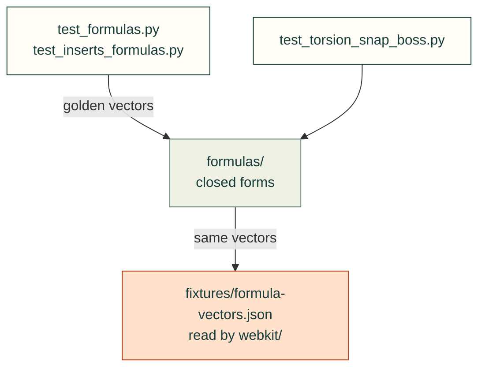

# tests/formulas

Tests for [`src/cadagent/formulas/`](../../src/cadagent/formulas/README.md): each closed form against a published
worked example or a derivation written out in the test.

Arrows: what a test imports, runs or reads.

| File | What it tests |
|---|---|
| `__init__.py` | Empty: makes the folder a package, so a test here may share a file name with one in another folder |
| `test_bearings.py` | Rolling bearings: ISO 281 life and ISO 76 static safety against the makers' worked examples |
| `test_formulas.py` | `cadagent.formulas` against worked examples from the cited sources, or derivations written out here |
| `test_inserts_formulas.py` | Threaded inserts and compression limiters: golden vectors and an independent derivation |
| `test_torsion_snap_boss.py` | The torsion-bar snap and the screw in a printed boss, against Saint-Venant and thread statics |

Run: `pytest tests/formulas` (with `PYTHONPATH=src`).

Related: [tests](../README.md) · [where files go](../../CONTRIBUTING.md#where-files-go)
