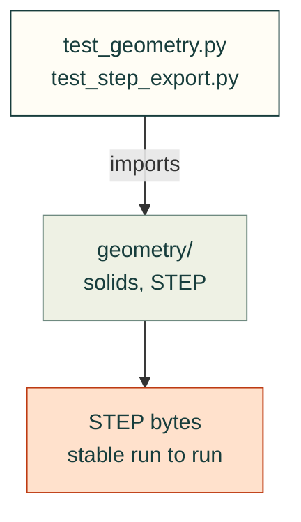

# tests/geometry

Tests for [`src/cadagent/geometry/`](../../src/cadagent/geometry/README.md): the shared CAD helpers and reproducible
STEP. Most need CadQuery and skip cleanly without it.

Arrows: what a test imports, runs or reads.

| File | What it tests |
|---|---|
| `__init__.py` | Empty: makes the folder a package, so a test here may share a file name with one in another folder |
| `test_geometry.py` | `cadagent.geometry` helpers on real CadQuery solids |
| `test_part_cache.py` | `PartCache`: the BREP cache of built parts, keyed by their sources |
| `test_step_export.py` | Reproducible STEP export: `export_step`, `step_timestamp` and assemblies |

Run: `pytest tests/geometry` (with `PYTHONPATH=src`).

Related: [tests](../README.md) · [where files go](../../CONTRIBUTING.md#where-files-go)
