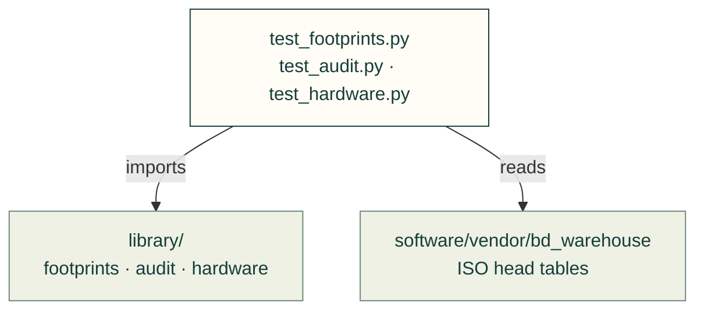
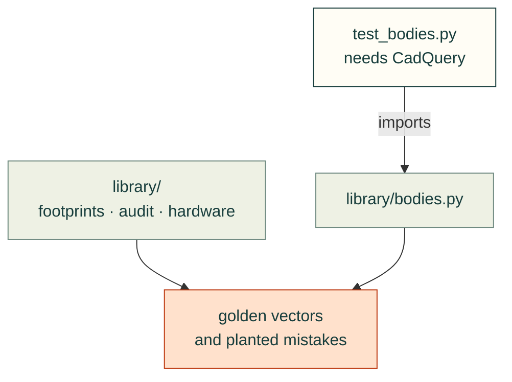

# tests/library

Tests for [`software/cadagent/library/`](../../software/cadagent/library/README.md): footprints and bodies against their
datasheets, the model audit, registration, and the hardware tables against their source.

Arrows: what a test imports, runs or reads.

Library rules and source tables

Geometry and shared expectations

| File | What it tests |
|---|---|
| `__init__.py` | Empty: makes the folder a package, so a test here may share a file name with one in another folder |
| `test_footprints.py` | Pads against the datasheets' tables (golden vectors), the written KiCad file, the S-expression reader |
| `test_audit.py` | The model audit and the registration check, each rule shown failing on a planted mistake |
| `test_hardware.py` | ISO head rows against the vendored `bd_warehouse` CSVs; the `register()` hook |
| `test_bodies.py` | Every CadQuery body registers on its footprint and matches its datasheet envelope; STEP bytes are reproducible (skips without CadQuery) |

Run: `pytest tests/library` (with `PYTHONPATH=software`).

Related: [tests](../README.md) · [where files go](../../.github/CONTRIBUTING.md#where-files-go)
