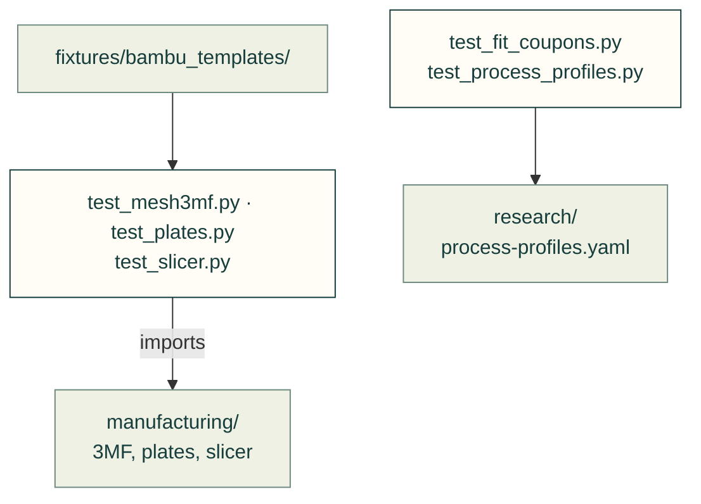

# tests/manufacturing

Tests for [`src/cadagent/manufacturing/`](../../src/cadagent/manufacturing/README.md): 3MF files, build plates, slicer
numbers, fit coupons and the process profiles they read.

Arrows: what a test imports, runs or reads.

| File | What it tests |
|---|---|
| `__init__.py` | Empty: makes the folder a package, so a test here may share a file name with one in another folder |
| `test_fit_coupons.py` | `cadagent.manufacturing.fit_coupons`: sizes from the process profile, one watertight coupon |
| `test_mesh3mf.py` | The 3MF writer and its read-back, on hand-built meshes |
| `test_plates.py` | Build plates: packing rules, the Bambu Studio project 3MF, byte stability |
| `test_process_profiles.py` | `research/process-profiles.yaml`: every rule sourced, with units, in step with its page |
| `test_slicer.py` | Slicer profile flattening (the slicer runs only where it is installed) |

Run: `pytest tests/manufacturing` (with `PYTHONPATH=src`).

Related: [tests](../README.md) · [where files go](../../CONTRIBUTING.md#where-files-go)
