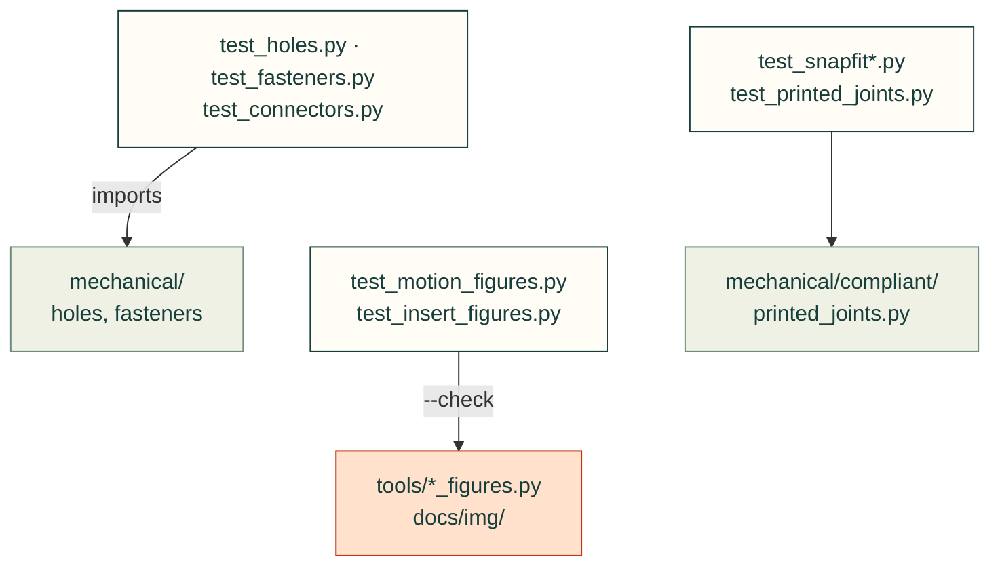

# tests/mechanical

Tests for [`src/cadagent/mechanical/`](../../src/cadagent/mechanical/README.md): holes, fasteners, connectors,
inserts, compliant features, linkages and motion traces, and the figures drawn from them.

Arrows: what a test imports, runs or reads.

| File | What it tests |
|---|---|
| `__init__.py` | Empty: makes the folder a package, so a test here may share a file name with one in another folder |
| `test_clearance.py` | `cadagent.mechanical.clearance`: range-of-motion collisions and swept-volume cutters |
| `test_connectors.py` | Mating-connector envelopes, windows and the 3D plug-fit check |
| `test_fasteners.py` | `cadagent.mechanical.fasteners`: screw stacks, bottomed and short screws, wall ribs |
| `test_holes.py` | `cadagent.mechanical.holes` and `cad-agent holes`: clearance, counterbores, ledges |
| `test_insert_figures.py` | The threaded-insert figures stay in step with `cadagent.mechanical.inserts` |
| `test_linkages.py` | Five-bar closed forms and the sweeps in `cadagent.mechanical.linkages` |
| `test_markings.py` | `cadagent.mechanical.markings`: engraved strokes and lettering export as valid solids |
| `test_mcmaster.py` | `cadagent.mechanical.mcmaster` without the network, on the pages in `fixtures/mcmaster/` |
| `test_mechanical_inserts.py` | Insert data and sources, hole and boss rules, the calibration and the joint check |
| `test_motion_figures.py` | The animated concept figures (`tools/motion_figures.py`) match the tests they copy |
| `test_motion_trace.py` | `cadagent.mechanical.motion_trace` on an independent analytic fixture |
| `test_printed_joints.py` | `cadagent.mechanical.printed_joints`: printed-part load pitfalls, each with a planted defect |
| `test_snapfit.py` | The snap-fit calculator against the Covestro guide's worked examples, plus its check rows |
| `test_snapfit_sheets.py` | The printed snap-fit allowables pinned to the data-sheet editions they cite |

Run: `pytest tests/mechanical` (with `PYTHONPATH=src`).

Related: [tests](../README.md) · [where files go](../../CONTRIBUTING.md#where-files-go)
