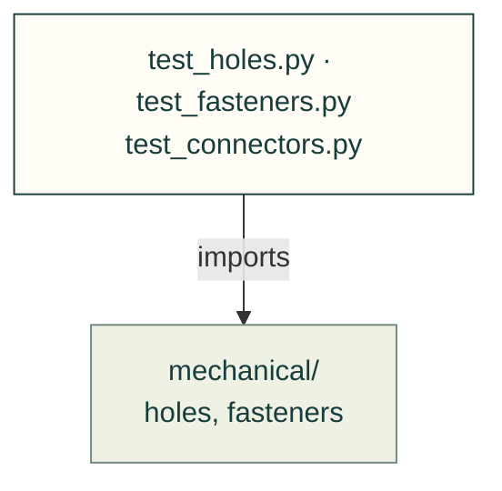
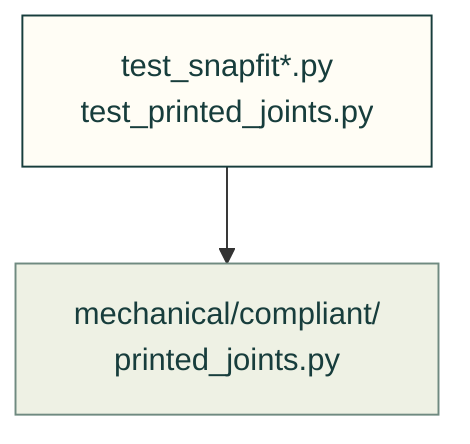
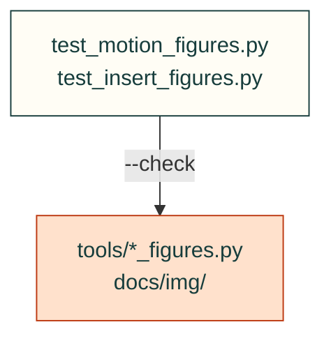

# tests/mechanical

Tests for [`software/cadagent/mechanical/`](../../software/cadagent/mechanical/README.md): holes, fasteners, connectors,
inserts, compliant features, linkages and motion traces, and the figures drawn from them.

Arrows: what a test imports, runs or reads.

Mechanical checks

Printed joint checks

Generated figure checks

| File | What it tests |
|---|---|
| `__init__.py` | Empty: makes the folder a package, so a test here may share a file name with one in another folder |
| `test_clearance.py` | `cadagent.mechanical.clearance`: range-of-motion collisions and swept-volume cutters |
| `test_connectors.py` | Mating-connector envelopes, windows and the 3D plug-fit check |
| `test_fasteners.py` | `cadagent.mechanical.fasteners`: screw stacks, bottomed and short screws, wall ribs |
| `test_holes.py` | `cadagent.mechanical.holes` and `cad-agent holes`: clearance, counterbores, ledges |
| `test_insert_figures.py` | The threaded-insert figures stay in step with `cadagent.mechanical.inserts` |
| `test_linkages.py` | Five-bar closed forms and the sweeps in `cadagent.mechanical.linkages` |
| `test_markings.py` | `cadagent.mechanical.markings`: engraved strokes and lettering export as valid solids |
| `test_mcmaster.py` | `cadagent.mechanical.mcmaster` without the network, on the pages in `fixtures/mcmaster/` |
| `test_mechanical_inserts.py` | Insert data and sources, hole and boss rules, the calibration and the joint check |
| `test_motion_figures.py` | The animated concept figures (`tools/figures/motion_figures.py`) match the tests they copy |
| `test_motion_trace.py` | `cadagent.mechanical.motion_trace` on an independent analytic fixture |
| `test_printed_joints.py` | `cadagent.mechanical.printed_joints`: printed-part load pitfalls, each with a planted defect |
| `test_clinch.py` | `cadagent.mechanical.clinch`: the parts against PEM's bulletins, SendCutSend's worked 1/4-20 example, spacing both ways, BA/2 + E to a bend, hardness by material, thickness, hole, loads and `parts_for` |
| `test_rivets.py` | `cadagent.mechanical.rivets`: the catalogue rivets, the worked lap joint, grip with tolerance, edge, pitch, hole, thin sheet, metals and load |
| `test_sheet_hardware.py` | `cadagent.mechanical.sheet_hardware`: the catalogue loads and every item is a part the checks know, with its kind, sources and installed block; the choosers rank by price; `cost` totals pieces, packs and a shop's price |
| `test_snapfit.py` | The snap-fit calculator against the Covestro guide's worked examples, plus its check rows |
| `test_snapfit_sheets.py` | The printed snap-fit allowables pinned to the data-sheet editions they cite |

Run: `pytest tests/mechanical` (with `PYTHONPATH=software`).

Related: [tests](../README.md) · [where files go](../../.github/CONTRIBUTING.md#where-files-go)
