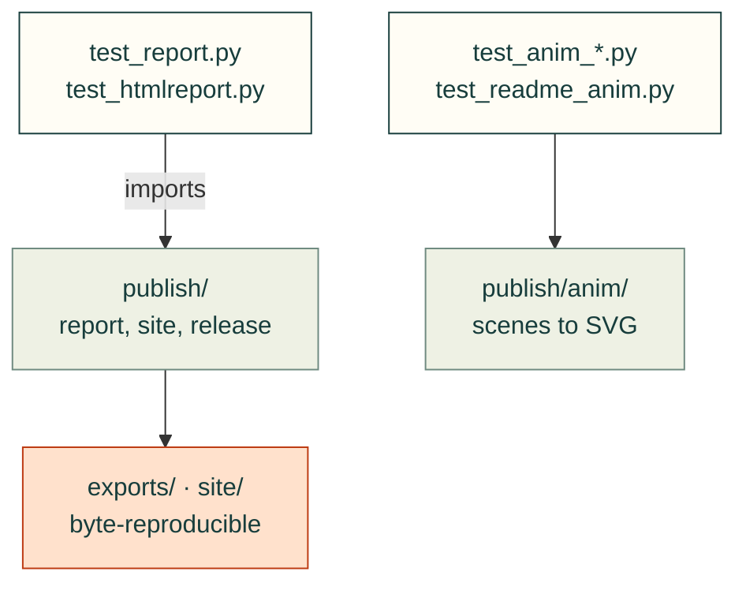

# tests/publish

Tests for [`software/cadagent/publish/`](../../software/cadagent/publish/README.md): results JSON, reports, renders, 3D views, a
project's site, the print release and the animated figures.

Arrows: what a test imports, runs or reads.

| File | What it tests |
|---|---|
| `__init__.py` | Empty: makes the folder a package, so a test here may share a file name with one in another folder |
| `test_anim_convergence.py` | The animated mesh-convergence figure, drawn from its committed scene |
| `test_anim_snapfit.py` | The animated snap-fit figure, drawn from the snap-fit calculator |
| `test_htmlreport.py` | `canonical_status` never upgrades to pass; `render_page` shows every row |
| `test_readme_anim.py` | The animated README figures are what their scenes render to, and safe to embed |
| `test_release.py` | The print release page: parts, slicer settings and slice state, pick-one groups, totals |
| `test_release_guides.py` | Guide dependency identity, hash binding, immutable preflight bytes and refusal of unsafe or stale inputs |
| `test_render.py` | The offscreen renderer makes a captioned PNG (needs vtk and Pillow) |
| `test_report.py` | `collect()` and `write_report()`: schema 1.0 results; failures never read as passes |
| `test_reproducible_outputs.py` | The review zip, report pages and the dates they record are byte-reproducible |
| `test_site.py` | A project's site (`cadagent.publish.site`): milestones, decisions, designs, pages, history |
| `test_site_review.py` | The project site's review pages, built from the gate-bench fixture |
| `test_view.py` | `cadagent.publish.view`: STL round trips and the 3D view export, bad input refused before writing |

Run: `pytest tests/publish` (with `PYTHONPATH=software`).

Related: [tests](../README.md) · [where files go](../../.github/CONTRIBUTING.md#where-files-go)

## Assembly guide release test plan

This is the packaging portion of the versioned assembly-guide test specification
([cad-agent #302](https://github.com/Valpatel/cad-agent/issues/302),
[Gyropup #266](https://github.com/Valpatel/gyropup/issues/266)). It accompanies
`publish/guides.py` and the existing release builder. Synthetic byte fixtures
exercise packaging integrity, not CAD parsing, rendered geometry or physical fit.

| Requirement | Check | Status |
|---|---|---|
| Every referenced model, mesh and poster is present and current | Collector tests remove or replace each kind; actual hashes must fail | Implemented |
| A checked snapshot cannot change between preflight and copy | Mutate a source after collection; captured bytes remain identical | Implemented |
| References stay local and inside the project | External/root/query/fragment/encoded escape and symlink controls | Implemented |
| Instance, step and snapshot identities are unambiguous | Unknown parts, hidden highlights, duplicate IDs and forward prerequisites | Implemented |
| Explode coordinates are finite CAD-mm vectors | NaN and Boolean-vector negatives | Implemented |
| A rejected guide preserves the old release | Build with a prior release, corrupt each guide dependency, require its files/ZIP unchanged | Pending release integration |
| Downloaded guides retain the actual runtime and relative links | Extract ZIP in a fresh directory and open the pinned reader/model/posters; no current-site requests | Pending shared reader/integration |
| Released bytes are reproducible | Two builds of two distinct snapshots, compare all hashes and ZIP bytes | Pending release integration |
| The index links the guide and static instructions work without WebGL | Inspect release HTML and load fallback; check step images/text | Pending release integration |

Focused command: `PYTHONPATH=software pytest -q tests/publish/test_release_guides.py`.
Normal release regressions: `PYTHONPATH=software pytest -q tests/publish/test_release.py`.
The shared viewer and product specifications own actual multipart render state,
version switching, phone/keyboard controls, late-load cancellation and disposal.
Packaging checks alone cannot claim those features work.
