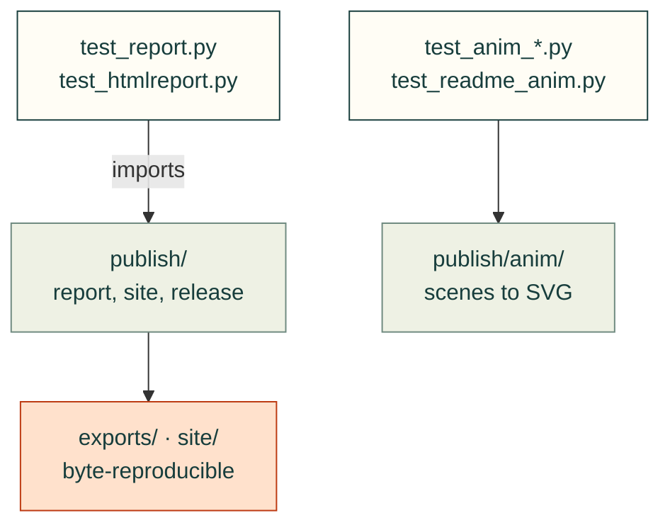

# tests/publish

Tests for [`src/cadagent/publish/`](../../src/cadagent/publish/README.md): results JSON, reports, renders, 3D views, a
project's site, the print release and the animated figures.

Arrows: what a test imports, runs or reads.

| File | What it tests |
|---|---|
| `__init__.py` | Empty: makes the folder a package, so a test here may share a file name with one in another folder |
| `test_anim_convergence.py` | The animated mesh-convergence figure, drawn from its committed scene |
| `test_anim_snapfit.py` | The animated snap-fit figure, drawn from the snap-fit calculator |
| `test_htmlreport.py` | `canonical_status` never upgrades to pass; `render_page` shows every row |
| `test_readme_anim.py` | The animated README figures are what their scenes render to, and safe to embed |
| `test_release.py` | The print release page: parts, slicer settings and slice state, pick-one groups, totals |
| `test_render.py` | The offscreen renderer makes a captioned PNG (needs vtk and Pillow) |
| `test_report.py` | `collect()` and `write_report()`: schema 1.0 results; failures never read as passes |
| `test_reproducible_outputs.py` | The review zip, report pages and the dates they record are byte-reproducible |
| `test_site.py` | A project's site (`cadagent.publish.site`): milestones, decisions, designs, pages, history |
| `test_site_review.py` | The project site's review pages, built from the gate-bench fixture |
| `test_view.py` | `cadagent.publish.view`: STL round trips and the 3D view export, bad input refused before writing |

Run: `pytest tests/publish` (with `PYTHONPATH=src`).

Related: [tests](../README.md) · [where files go](../../CONTRIBUTING.md#where-files-go)
