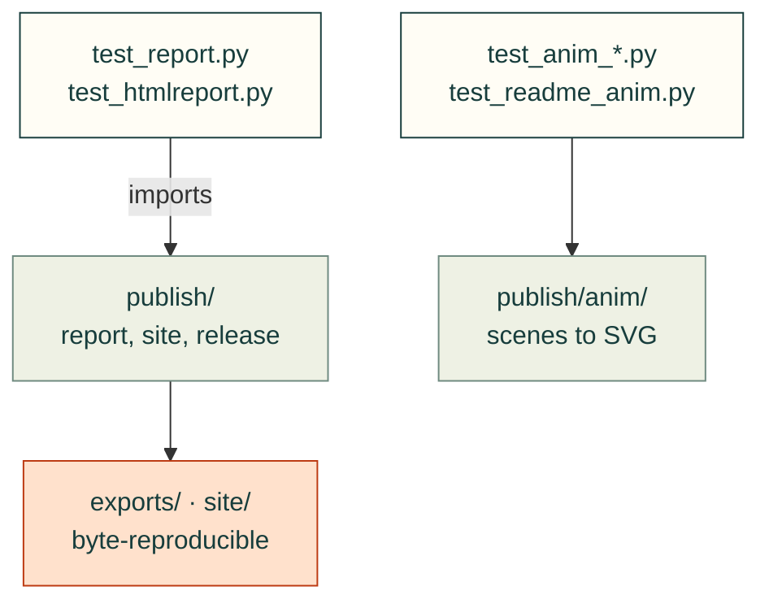

# tests/publish

Tests for [`software/cadagent/publish/`](../../software/cadagent/publish/README.md): results JSON, reports, renders, 3D views, a
project's site, the print release and the animated figures.

Arrows: what a test imports, runs or reads.

| File | What it tests |
|---|---|
| `__init__.py` | Empty: makes the folder a package, so a test here may share a file name with one in another folder |
| `test_anim_convergence.py` | The animated mesh-convergence figure, drawn from its committed scene |
| `test_anim_snapfit.py` | The animated snap-fit figure, drawn from the snap-fit calculator |
| [test_homepage_art.py](test_homepage_art.py) | Recorded homepage sample values, failed solver criteria and conceptual hero still-state contract |
| `test_htmlreport.py` | `canonical_status` never upgrades to pass; `render_page` shows every row |
| `test_readme_anim.py` | The animated README figures are what their scenes render to, and safe to embed |
| `test_release.py` | The print release page: parts, slicer settings and slice state, pick-one groups, totals |
| `test_release_guides.py` | Guide dependency identity, hash binding, immutable preflight bytes and refusal of unsafe or stale inputs |
| `assembly_release_fixture.py` | Builds real synthetic guide geometry/releases and extracts a portable ZIP for the persistent browser suite, then removes its source |
| `test_render.py` | The offscreen renderer makes a captioned PNG (needs vtk and Pillow) |
| `test_report.py` | `collect()` and `write_report()`: schema 1.0 results; failures never read as passes |
| `test_reproducible_outputs.py` | The review zip, report pages and the dates they record are byte-reproducible |
| `test_site.py` | A project's site (`cadagent.publish.site`): milestones, decisions, designs, pages, history |
| `test_site_review.py` | The project site's review pages, built from the gate-bench fixture |
| `test_view.py` | `cadagent.publish.view`: STL round trips and the 3D view export, bad input refused before writing |

Run: `pytest tests/publish` (with `PYTHONPATH=software`).

Related: [tests](../README.md) · [where files go](../../.github/CONTRIBUTING.md#where-files-go)

## Assembly guide release test plan

Portable guide requirements, commands and retained evidence

This is the packaging portion of the versioned assembly-guide test specification
([cad-agent #302](https://github.com/Valpatel/cad-agent/issues/302),
[Gyropup #266](https://github.com/Valpatel/gyropup/issues/266)). It accompanies
`publish/guides.py` and the existing release builder. Synthetic byte fixtures
exercise packaging integrity, not CAD parsing, rendered geometry or physical fit.

| Requirement | Check | Status |
|---|---|---|
| Every referenced model, mesh and poster is present and current | Collector tests remove or replace each kind; actual hashes must fail | Implemented |
| A checked snapshot cannot change between preflight and copy | Mutate a source after collection; captured bytes remain identical | Implemented |
| References stay local and inside the project | External/root/query/fragment/encoded escape and symlink controls | Implemented |
| Instance, step and snapshot identities are unambiguous | Unknown parts, hidden highlights, duplicate IDs and forward prerequisites | Implemented |
| Explode coordinates are finite CAD-mm vectors | NaN and Boolean-vector negatives | Implemented |
| A rejected guide preserves the old release | Build with a prior release, corrupt each guide dependency, require its files/ZIP unchanged | Implemented |
| Downloaded guides retain runtime and relative links | Extract ZIP after deleting the source and original release; verify every byte/hash and use the actual reader query | Chromium and WebKit passed at `47b07508` with the shared `cdbee23b` runtime |
| Released bytes are reproducible | Two builds of two distinct snapshots, compare all hashes and ZIP bytes | Implemented |
| The index links the guide and static instructions survive disabled JavaScript | Actual generated entry, image decoding and text in a JavaScript-disabled browser context | Both engines passed at `47b07508`; product no-WebGL handling is separate |
| Python packaging and JavaScript reader accept the same schema | Eleven on-disk fixtures through both actual validators, including cumulative cross-chapter context | Implemented; all eleven pass after shared composition |
| Navigation readiness tolerates an absent body but requires the exact ready signal | Browser removes body, rejects ready `0`, then supplies ready `1`; old predicate must throw | Both local engines passed eight cases including this control; current corrective-head CI required |
| Reset controls match the scene and selected appearance affects only its instance | Real dropdowns, reset overview, per-instance materials, resume/back/next and override clearing | Both engines passed at `47b07508` |

Focused command: `PYTHONPATH=software pytest -q tests/publish/test_release_guides.py`.
Normal release regressions: `PYTHONPATH=software pytest -q tests/publish/test_release.py`.
Repository release-note consumption: `PYTHONPATH=software pytest -q tests/repo/test_cut_release.py`.
The shared viewer and product specifications own actual multipart render state,
version switching, phone/keyboard controls, late-load cancellation and disposal.
Packaging checks alone cannot claim those features work.

Enable this optional packaging path with `cad.release.assembly_guides`, a list of
project-relative guide JSON paths. The release retains original relative paths
under each snapshot's `project/` folder and copies the installed web kit once
under its own relative `guides/_cadagent/` folder. The HTML index links both
static instructions and the shared interactive reader; no live-site runtime is
required. The normal release manifest hashes every copied runtime/data byte.
The reader requires a local/static HTTP server for browser fetches; static
instructions and posters also remain directly readable from an extracted ZIP.

Persistent browser command: `npm --prefix tools/site run test:assembly-release`
(set `PLAYWRIGHT_BROWSER=webkit` for the second engine). The required browser CI
matrix runs it after installing the ordinary Python site dependencies. The
test's standalone Python fixture builds two deliberately different releases
and one exact-source WIP, extracts the real ZIP, and deletes its source project.
An isolated test-owned HTTP listener serves only those extracted bytes. Actual
shared reader controls, stage transforms/material reset, static no-script
diagrams, local-only requests and corrupted guide/model/mesh refusal are checked;
`finally` closes its browser and listener. Diagrams are labelled synthetic
plan-view fixtures; real Gyropup posters have separate rendering/source checks.

The latest portable run used actual packaged runtime bytes from shared source
`cdbee23b` and recorded seven case rows per engine: two distinct synthetic
releases, WIP, three corruption controls and static no-script fallback. Both
engines reported zero page errors and zero requests outside the extracted
bundle. Each scene checked a real draw before ready, selected-part appearance
independence and reset/step restoration. These checks establish portable viewer
behavior, not complete Gyropup recipe accuracy or physical assembly.

The final-runtime local runs with shared `d0d13ee3` also passed seven cases in each engine, with zero page errors
and foreign requests. They additionally compare the packaged camera-target vector to an independently specified
underside direction. The original source and release folders were removed before browser access. Both owned
units and the separate two-engine documentation probe terminated with no remaining tasks. The latter measured
the newly folded publisher reference at 265/264 px (Chromium/WebKit) against the unchanged 1200 px wall limit;
the old 2052/2015 px CI failures remain failures. Current composed-head CI remains required.

The first changed portable test at `3b7d4f7f` timed out because it clicked Previous
from the intentional assembled overview. The corrected test explicitly checks
that Previous is disabled there and selects an instruction before testing
backward navigation. This preserves the UI contract instead of changing the
product to satisfy a faulty test assumption. CI also rejected a malformed
CHANGELOG fragment; the existing repository release-producer tests now pass
all 40 cases. Both failed attempts remain separate from the corrected results.

