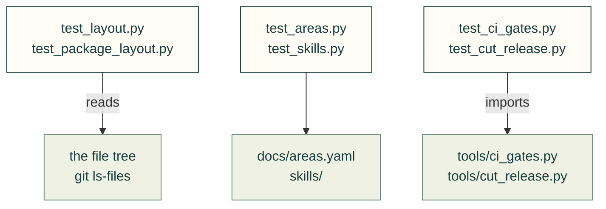

# tests/repo

Tests of the repository's own rules and tooling, not of a package: the topic tree, where files go, private names,
skills, the merge gates, releases, the supply-chain audit and vendored files.

Arrows: what a test imports, runs or reads.

| File | What it tests |
|---|---|
| `__init__.py` | Empty: makes the folder a package, so a test here may share a file name with one in another folder |
| `test_areas.py` | `docs/areas.yaml`, the topic tree: it parses, and everything it names exists and is placed |
| `test_ci_gates.py` | The merge gates in `tools/ci_gates.py`: branch flow, review verdicts, release versions |
| `test_cut_release.py` | `tools/cut_release.py`: the release-branch edits, checked against CI's release gate |
| `test_layout.py` | Where files go: no flat tests, no new top-level folders, folders split as they grow |
| `test_package_areas.py` | Each domain package holds one domain of `docs/areas.yaml`, and the two stay in step |
| `test_package_layout.py` | The package layout: modules in domain packages, old paths still import, a tidy top |
| `test_private_names.py` | No tracked file names a private predecessor tool |
| `test_resource_audit.py` | The supply-chain report in `tools/resource_audit.py`, offline |
| `test_skills.py` | Lint for `skills/<name>/SKILL.md`: front matter, links, and that what a skill names exists |
| `test_vendor_sync.py` | `tools/vendor_sync.py` rebuilds only the vendored table in `THIRD_PARTY_NOTICES.md` |

Run: `pytest tests/repo` (with `PYTHONPATH=src`).

Related: [tests](../README.md) · [where files go](../../CONTRIBUTING.md#where-files-go)
