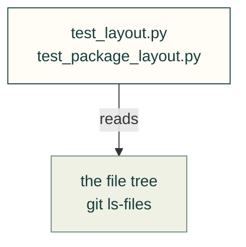
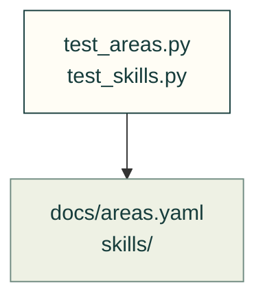
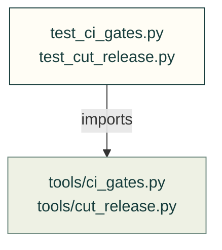

# tests/repo

Tests of the repository's own rules and tooling, not of a package: the topic tree, where files go, private names,
skills, the merge gates, releases, the supply-chain audit and vendored files.

Arrows: what a test imports, runs or reads.

Layout checks

Area and skill checks

Review and release checks

| File | What it tests |
|---|---|
| `__init__.py` | Empty: makes the folder a package, so a test here may share a file name with one in another folder |
| `test_agent_prompt.py` | What people paste and agents read (`docs/agent-prompt.txt`): the README opens with the install commands and the paste-in line, in about 125 words; its commands and report fields hold, and `tools/quickstart_eval.py` grades runs honestly |
| `test_fetch_user_agent.py` | Every Python fetch in `src/` and `tools/` sends its own User-Agent (the site's CDN blocks urllib's default), and agents are told the same |
| `test_areas.py` | `docs/areas.yaml`, the topic tree: it parses, and everything it names exists and is placed |
| `test_ci_apt_mirror.py` | Hosted runner profile and mirror priorities; isolated loopback apt failover preserves signature rejection |
| `test_ci_gates.py` | The merge gates in `tools/ci_gates.py`: branch flow, review verdicts, release versions |
| `test_cut_release.py` | `tools/cut_release.py`: the release-branch edits, checked against CI's release gate |
| `test_layout.py` | Where files go: no flat tests, no new top-level folders, folders split as they grow |
| `test_package_areas.py` | Each domain package holds one domain of `docs/areas.yaml`, and the two stay in step |
| `test_package_layout.py` | The package layout: modules in domain packages, old paths still import, a tidy top |
| `test_private_names.py` | No tracked file names a private predecessor tool |
| `test_resource_audit.py` | The supply-chain report in `tools/resource_audit.py`, offline |
| `test_skills.py` | Lint for `skills/<name>/SKILL.md`: front matter, links, and that what a skill names exists |
| `test_vendor_sync.py` | `tools/vendor_sync.py` rebuilds only the vendored table in `THIRD_PARTY_NOTICES.md` |

Run: `pytest tests/repo` (with `PYTHONPATH=software`).

Related: [tests](../README.md) · [where files go](../../.github/CONTRIBUTING.md#where-files-go)

## File and child ownership

| File or folder | Purpose |
|---|---|
| [test_import_refmap.py](test_import_refmap.py) | Reference importer canonical output and split records. |
| [test_markdown_images.py](test_markdown_images.py) | Committed Markdown image destinations. |
| [test_references_health.py](test_references_health.py) | Reference registry health and maintenance layout. |
| [test_references_health_apply.py](test_references_health_apply.py) | Reference-health patch application controls. |
| [evaluation/](evaluation/README.md) | Analytical jobs, candidate catalog, collectors and optional Inspect qualification controls. |
