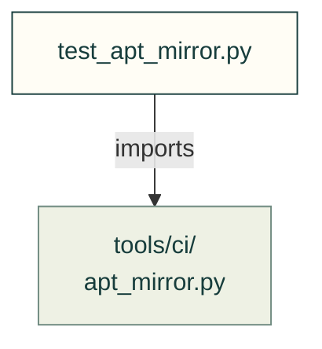
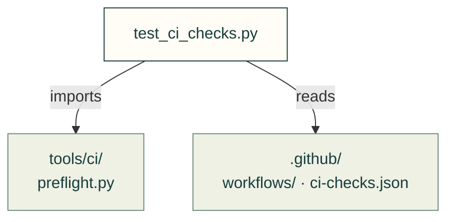

# tests/repo/ci

Tests of the CI support tools in [`tools/ci/`](../../../tools/ci/README.md): the hosted-runner apt-mirror correction,
and the local preflight with the guard that keeps its mapping in step with the workflows.

Arrows: what a test imports or reads.

Runner provisioning

Local preflight and its drift guard

| File | What it tests |
|---|---|
| `__init__.py` | Empty: a package, so these files may share names with tests elsewhere |
| `test_apt_mirror.py` | Hosted runner profile and mirror priorities; isolated loopback apt failover preserves signature rejection |
| `test_ci_checks.py` | `.github/ci-checks.json` mirrors every check a pull-request workflow runs (and nothing stale), naming the step that lacks an entry; `tools/ci/preflight.py` matches paths, reports what cannot run here as not run, and exits non-zero only when a check that ran fails |

Run: `pytest tests/repo/ci` (with `PYTHONPATH=software`).

Related: [tests/repo](../README.md) · [tools/ci](../../../tools/ci/README.md)
