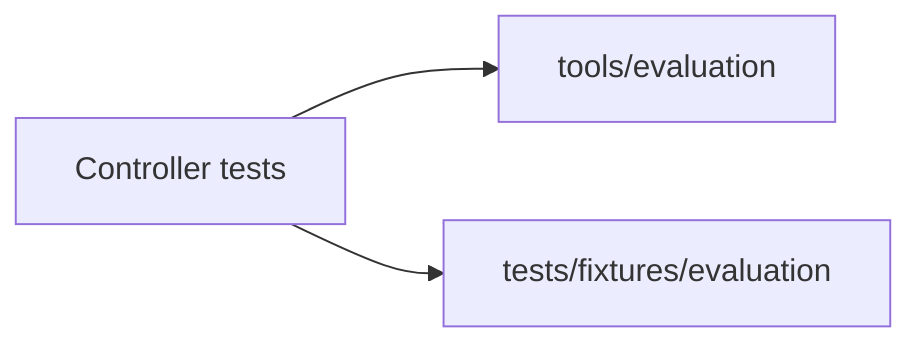

# Evaluation controller tests

These test the repository-owned evaluation corpus and tooling. Default runs do not call a model or create a container; optional runtime qualification must be explicitly selected and its prerequisites established.

| File | Purpose |
|---|---|
| [__init__.py](__init__.py) | Test package marker. |
| [test_eval_candidates.py](test_eval_candidates.py) | Planning catalog integrity and v1 boundaries. |
| [test_standard_eval.py](test_standard_eval.py) | Analytical jobs, independent graders and artifact ingestion. |
| [test_standard_eval_runner.py](test_standard_eval_runner.py) | CLI collection, retained service settlement and observed metrics. |
| [test_inspect_eval_runner.py](test_inspect_eval_runner.py) | Optional Inspect ownership, sealing, metadata probe and provider controls. |

[Repository tests](../README.md)
