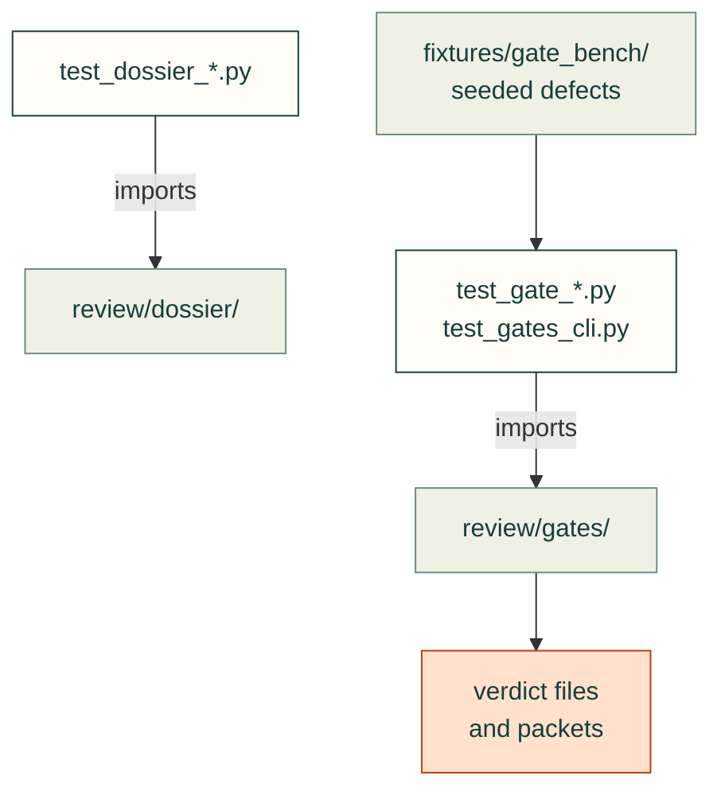

# tests/review

Tests for [`src/cadagent/review/`](../../src/cadagent/review/README.md): the design dossier, the integrity gates,
review packets and evidence hashes. Most gates run on a box world with no CAD kernel first, then on real geometry.

Arrows: what a test imports, runs or reads.

| File | What it tests |
|---|---|
| `__init__.py` | Empty: makes the folder a package, so a test here may share a file name with one in another folder |
| `test_dossier_lint.py` | The dossier lint and status machine: a failing and a passing case per rule |
| `test_dossier_load.py` | The design dossier's schema and loader |
| `test_dossier_registry.py` | The build-script registry: `@part`, `@cavity`, `@joint`, `fastener()`, the geometry export |
| `test_dossier_review.py` | The reviewer pass and its hash-bound sign-off |
| `test_gate_assembly.py` | Assembly-sequence access gate, on a box world and then real geometry |
| `test_gate_bench.py` | The gate bench: the clean fixture and each seeded defect |
| `test_gate_connectivity.py` | Connectivity and floating-parts gate |
| `test_gate_containment.py` | Containment gate: contents inside their container's cavity, per pose |
| `test_gate_fasteners.py` | Fastener and stack gate |
| `test_gate_motion.py` | Motion-range interference gate |
| `test_gate_relations.py` | Gate machinery: `Assembly`, broad phase, pairwise relations, the pair cache, verdicts |
| `test_gate_subassembly.py` | A rigid module passes its own sequence before it enters another assembly |
| `test_gate_wall.py` | Minimum-wall gate: mesh rays and exact B-rep rays |
| `test_gates_cli.py` | `cad-agent gates`: configuration, the plan, workers, verdict files, staleness |
| `test_hash_platform.py` | Content hashes are bound to the platform that made them |
| `test_packet.py` | The section review packet |
| `test_packet_pictures.py` | The review-packet pictures on the site stay tied to the run that drew them |
| `test_references.py` | The reference registry (`research/references.yaml`): entries well formed, every cited id resolves |
| `test_review.py` | `review_html` and the review page: local assets, no pass without a current check |
| `test_volume_precision.py` | Analytic controls for volume cancellation, topology and uncertain decisions |

Run: `pytest tests/review` (with `PYTHONPATH=src`).

Related: [tests](../README.md) · [where files go](../../CONTRIBUTING.md#where-files-go)
