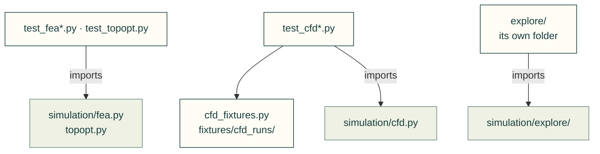

# tests/simulation

Tests for [`src/cadagent/simulation/`](../../src/cadagent/simulation/README.md): FEA, CFD, topology optimisation,
robot export, design exploration and their pictures and reports. `cfd_fixtures.py` is a helper the CFD tests import;
design exploration has its own folder, [`explore/`](explore/README.md).

Arrows: what a test imports, runs or reads.

| File | What it tests |
|---|---|
| `__init__.py` | Empty: makes the folder a package, so a test here may share a file name with one in another folder |
| `cfd_fixtures.py` | Helper: recorded-format CFD runs from `fixtures/cfd_runs/` (no solver runs) |
| [`explore/`](explore/README.md) | Design exploration (`cadagent.simulation.explore`): catalogue, design files, evaluation, compare, optimise |
| `test_cfd.py` | `cadagent.simulation.cfd` writes a complete OpenFOAM case (running it is opt-in) |
| `test_cfd_fan_faces.py` | Fan inlet and outlet temperatures, mass-flow weighted; energy balance flagged |
| `test_cfd_history.py` | `read_results` keeps the whole run: residual and temperature histories |
| `test_fea.py` | The FEA solver against textbook answers: a cantilever and a twisted shaft |
| `test_fea_layers.py` | The layer check and material record of `cadagent.simulation.fea` |
| `test_fea_materials.py` | The FEA material table pinned to the data sheets it cites |
| `test_fea_mesh.py` | Mesh control: local refinement, the mesher's identity, slivers and refusals |
| `test_fit_mesh.py` | `fit_mesh`: an STL over its face budget comes back under it |
| `test_robot.py` | Robot export: mass properties, URDF writing and checking |
| `test_simreport.py` | The simulation report page: comparison words, media and limits |
| `test_simviz.py` | House framing for simulation pictures |
| `test_simviz_convergence.py` | `convergence_chart`: the whole run and the values a convergence claim rests on |
| `test_stl_faces.py` | `stl_faces` with no optional dependencies: binary and ASCII STLs, truncated files |
| `test_topopt.py` | Topology optimisation (pyMOTO) on a small cantilever |

Run: `pytest tests/simulation` (with `PYTHONPATH=src`).

Related: [tests](../README.md) · [where files go](../../CONTRIBUTING.md#where-files-go)
