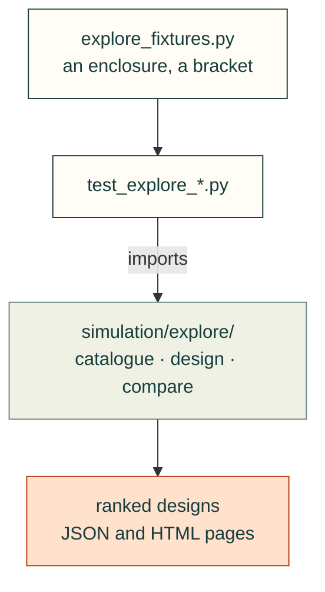

# tests/simulation/explore

Tests for [`src/cadagent/simulation/explore/`](../../../src/cadagent/simulation/explore/): design exploration, from a
catalogue of parts to ranked designs. `explore_fixtures.py` holds the small projects they share; the `cad-agent
catalogue`, `compare` and `optimise` commands run end to end in `test_explore_cli.py`.

Arrows: what a test imports, runs or reads.

| File | What it tests |
|---|---|
| `__init__.py` | Empty: makes the folder a package, so a test here may share a file name with one in another folder |
| `explore_fixtures.py` | Helper: small projects these tests import (an enclosure and a bracket) |
| `test_explore_catalogue.py` | `explore.catalogue`: layouts, loading problems and per-item checks |
| `test_explore_charts.py` | The catalogue's compare cover matches `cad-agent compare` |
| `test_explore_cli.py` | `cad-agent catalogue`, `compare` and `optimise`, end to end |
| `test_explore_compare.py` | `explore.compare` and its page: Pareto ranking, swaps, JSON, HTML |
| `test_explore_design.py` | `explore.design`: design files, extends, slots and the bill of materials |
| `test_explore_evaluate.py` | `explore.evaluate`: the evaluators, goals and verdicts |
| `test_explore_optimise.py` | `explore.optimise`: the search space, samplers, resuming, optuna when installed |

Run: `pytest tests/simulation/explore` (with `PYTHONPATH=src`).

Related: [parent](../README.md) · [tests](../../README.md) · [where files go](../../../CONTRIBUTING.md#where-files-go)
