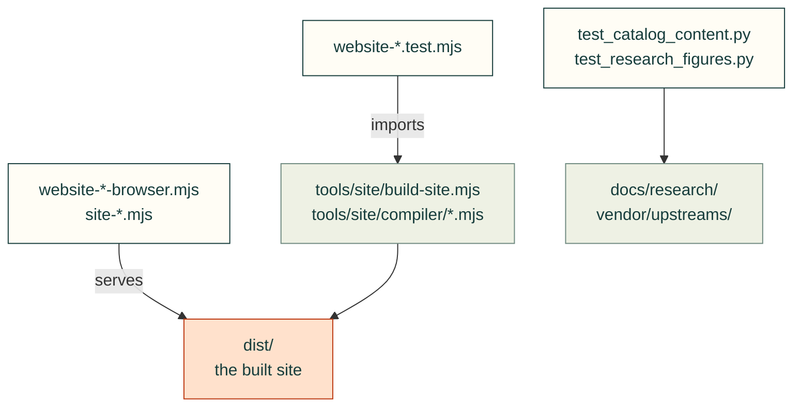

# tests/site

Tests for cad-agent's own website (cad-agent.valpatel.com) and its build: `tools/site/build-site.mjs` and the
`tools/site/compiler/*.mjs` tools, the catalogue, the research charts. A project's site is `cadagent.publish.site`, tested in
[`publish/`](../publish/README.md).

Arrows: what a test imports, runs or reads.

| File | What it tests |
|---|---|
| `__init__.py` | Empty: makes the folder a package, so a test here may share a file name with one in another folder |
| `built-site.mjs` | Helper: the built site the `website-*` tests read, from `CAD_AGENT_SITE` or a fresh build of HEAD |
| `site-diagrams-browser.mjs` | The Python site consumer of the diagram renderer, in a real browser |
| `npm-context.mjs` | Test-only dependency resolution anchored at tools/site/package.json, without a root manifest or node_modules link |
| `site-motion.mjs` | Helper: rendered reduced-motion hero still and a hidden-drawing negative control |
| `site-walls.mjs` | Helper: measures walls of text in a real browser (imported by `website-browser.mjs`) |
| `test_catalog_content.py` | Every outside catalogue entry has a plain `what` line and a place in the topic tree |
| `test_research_figures.py` | The research charts are drawn from the tables on their pages |
| `website-browser.mjs` | The site's pages in a real browser, served as Cloudflare Pages serves them (a reference area page's filters included) |
| `website-build.test.mjs` | `tools/site/build-site.mjs`: what the build makes, links, redirects and headers |
| `website-catalog-browser.mjs` | The catalogue page in a real browser |
| `website-catalog.test.mjs` | The catalogue and its JSON files, built from HEAD |
| `website-diagrams.test.mjs` | `tools/site/compiler/site-diagrams.mjs`: Mermaid blocks drawn at build time |
| `website-html.test.mjs` | `tools/site/compiler/site-html.mjs`: the sanitizer keeps our markup and drops unsafe HTML |
| `website-references.test.mjs` | `tools/site/compiler/site-references.mjs`: the reference pages, their JSON and llms.txt lines against the committed records, `[ref:]` links, no record in the catalogue or llms-full.txt, `docs/practice/experts.md` current |
| `website-pages.test.mjs` | `tools/site/compiler/site-pages.mjs`: outputs placed on pages, section cards, folded reference |
| `website-snap-demo.test.mjs` | The landing page's snap-fit animation shows a real engagement |
| `website-theme.test.mjs` | The light and dark colour tokens: the same tokens in both, contrast in both, no stray light-only colour, and the theme script and button on every page |

Run: `node --test tests/site/website-*.test.mjs`, then `npm --prefix tools/site run test:site`; `pytest tests/site` for the Python files.

The files that read the whole site (`website-build`, `website-catalog` and the two `-browser` scripts) each build it
from HEAD into a temporary folder, unless `CAD_AGENT_SITE` names a folder already built from HEAD
(`node tools/site/build-site.mjs --out <dir> > <dir>.log`): then they all read that one, which is how CI builds the site
once per job. A folder built from another commit, or a `--worktree` draft, is refused; leave the variable unset to
build afresh.

Related: [tests](../README.md) · [where files go](../../.github/CONTRIBUTING.md#where-files-go)
