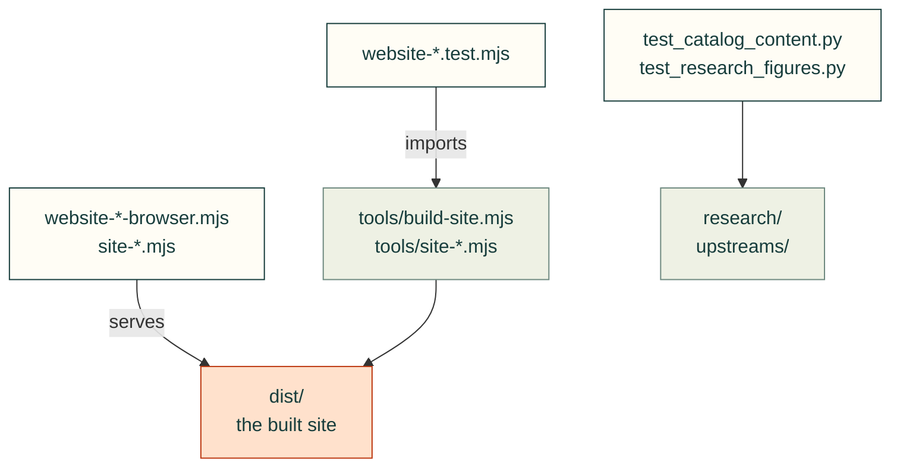

# tests/site

Tests for cad-agent's own website (cad-agent.valpatel.com) and its build: `tools/build-site.mjs` and the
`tools/site-*.mjs` tools, the catalogue, the research charts. A project's site is `cadagent.publish.site`, tested in
[`publish/`](../publish/README.md).

Arrows: what a test imports, runs or reads.

| File | What it tests |
|---|---|
| `__init__.py` | Empty: makes the folder a package, so a test here may share a file name with one in another folder |
| `site-diagrams-browser.mjs` | The Python site consumer of the diagram renderer, in a real browser |
| `site-walls.mjs` | Helper: measures walls of text in a real browser (imported by `website-browser.mjs`) |
| `test_catalog_content.py` | Every outside catalogue entry has a plain `what` line and a place in the topic tree |
| `test_research_figures.py` | The research charts are drawn from the tables on their pages |
| `website-browser.mjs` | The site's pages in a real browser, served as Cloudflare Pages serves them |
| `website-build.test.mjs` | `tools/build-site.mjs`: what the build makes, links, redirects and headers |
| `website-catalog-browser.mjs` | The catalogue page in a real browser |
| `website-catalog.test.mjs` | The catalogue and its JSON files, built from HEAD |
| `website-diagrams.test.mjs` | `tools/site-diagrams.mjs`: Mermaid blocks drawn at build time |
| `website-html.test.mjs` | `tools/site-html.mjs`: the sanitizer keeps our markup and drops unsafe HTML |
| `website-pages.test.mjs` | `tools/site-pages.mjs`: outputs placed on pages, section cards, folded reference |
| `website-snap-demo.test.mjs` | The landing page's snap-fit animation shows a real engagement |

Run: `node --test tests/site/website-*.test.mjs`, then `npm run test:site`; `pytest tests/site` for the Python files.

Related: [tests](../README.md) · [where files go](../../CONTRIBUTING.md#where-files-go)
