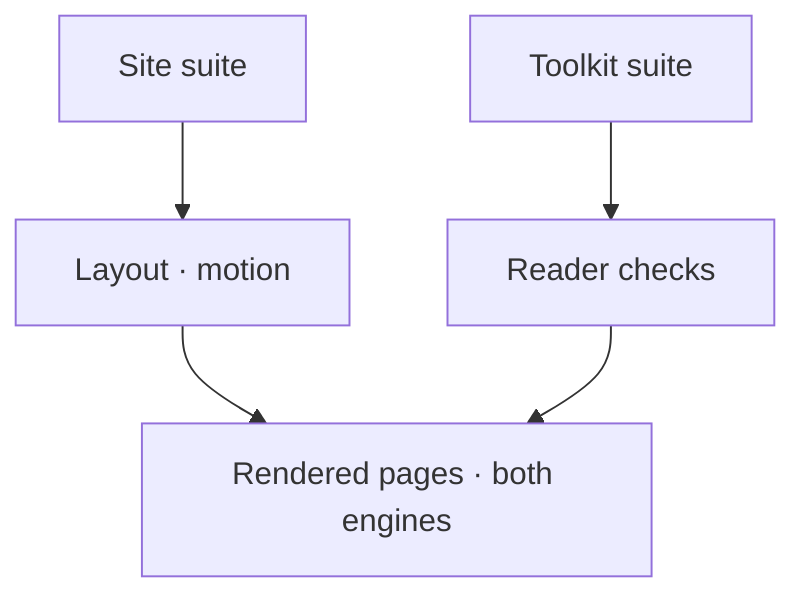

# Website layout checks

Browser helpers for the site's rendered layout. The parent runners choose the browser engine and serve the
actual built site; these helpers keep geometry, navigation and motion checks together.

| File | Checks |
|---|---|
| [motion.mjs](motion.mjs) | Rendered hero and image motion, reduced-motion stills, deferred models and negative controls. |
| [outline.mjs](outline.mjs) | Reader scroll boundaries, outline visibility, contrast and bounded failure receipts. |
| [walls.mjs](walls.mjs) | Stretches of text without visuals, citation reflow and planted text walls. |
| [wide.mjs](wide.mjs) | Representative wide-screen shells, gallery rows, bounded narrative text, flexible document visuals and hero size in both themes. |

`wide.mjs` runs through [the ordinary website browser suite](../website-browser.mjs) in each CI browser engine.
Its four viewports include 3440×1440. The checks measure real boxes after fonts and layout settle, then plant
the old shell cap, three-column gallery, unused Explore columns and an oversized hero to prove that each defect is detected. Pure
measurement controls live in [website-pages.test.mjs](../website-pages.test.mjs). This is representative layout
acceptance, not a visual audit of every published page; existing phone, reader and motion coverage still runs.

[Site tests](../README.md) · [All tests](../../README.md)
