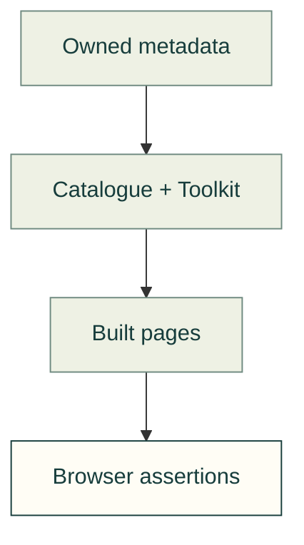

# Toolkit and discovery tests

Validate the website's shared catalogue identities, searchable capability pages and actual SCADA state previews.



| File | Responsibility |
|---|---|
| [website-catalog.test.mjs](website-catalog.test.mjs) | Published catalogue fields, local covers, package terms and native Toolkit routes. |
| [website-discovery.test.mjs](website-discovery.test.mjs) | Shared search identities, topic placement, reader links and payload budget. |
| [website-toolkit.test.mjs](website-toolkit.test.mjs) | Equipment, variants, state fields, scenario assets and malformed metadata rejection. |
| [website-catalog-browser.mjs](website-catalog-browser.mjs) | Explore, catalogue, reader and Toolkit flows in Chromium and WebKit. |
| [toolkit-browser.mjs](toolkit-browser.mjs) | Toolkit filters, native fallback, responsive layouts and actual state rendering. |
| [toolkit-examples-browser.mjs](toolkit-examples-browser.mjs) | Capability thumbnails and native links at phone, desktop and ultrawide widths; actual model, file, build-guide and calculator launch controls. |

Run from the repository root:

```sh
node --test tests/site/toolkit/website-*.test.mjs
node tests/site/toolkit/website-catalog-browser.mjs
```

Build-dependent checks use committed output through [built-site.mjs](../built-site.mjs). Browser checks reuse the
same Pages-style preview, error collection and dependency context as the [parent site suite](../README.md).

[Site tests](../README.md) · [Site compilers](../../../tools/site/compiler/README.md)
