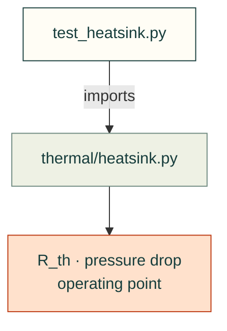

# tests/thermal

Tests for [`src/cadagent/thermal/`](../../src/cadagent/thermal/README.md): plate-fin heat sinks and fan operating
points. The fan curve formulas are tested in [`formulas/`](../formulas/README.md).

Arrows: what a test imports, runs or reads.

| File | What it tests |
|---|---|
| `__init__.py` | Empty: makes the folder a package, so a test here may share a file name with one in another folder |
| `test_heatsink.py` | Plate-fin heat sink model: limits, trends, the fan operating point and the porous fit |

Run: `pytest tests/thermal` (with `PYTHONPATH=src`).

Related: [tests](../README.md) · [where files go](../../CONTRIBUTING.md#where-files-go)
