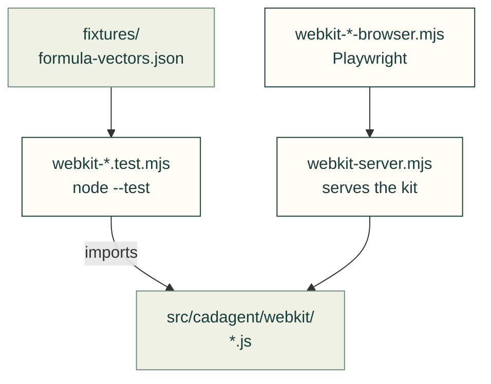

# tests/webkit

Node and browser tests for [`src/cadagent/webkit/`](../../src/cadagent/webkit/README.md), the browser pieces.
`*.test.mjs` run under `node --test` with no browser; `*-browser.mjs` drive Chrome or WebKit through Playwright; the
rest are helpers they import.

Arrows: what a test imports, runs or reads.

| File | What it tests |
|---|---|
| `__init__.py` | Empty: makes the folder a package, so a test here may share a file name with one in another folder |
| `webkit-diagrams-browser.mjs` | A pre-drawn diagram page in a real browser, in each theme |
| `webkit-fan-curve.test.mjs` | `<cad-fan-curve>` without a browser: every setting gives a point on both curves |
| `webkit-file-corpus.mjs` | Parses a bounded manifest of published originals with the real workers (run by hand) |
| `webkit-file-geometry.test.mjs` | `file-geometry.js`: mesh normalising and model and STL validation |
| `webkit-file-theme-browser.mjs` | Helper: the file viewer's themes in a browser (imported by the file-viewer suite) |
| `webkit-file-theme.test.mjs` | `file-viewer-theme.js`: theme normalising |
| `webkit-file-viewer-browser.mjs` | The original-file viewer in a real browser, on `fixtures/file-viewer/` |
| `webkit-file-worker-node.mjs` | Helper: runs the shipped parser workers in Node, without a browser |
| `webkit-formulas.test.mjs` | `formulas.js` against the golden vectors the Python writes |
| `webkit-fourbar.test.mjs` | `<cad-fourbar>`'s pure parts in Node |
| `webkit-gallery.test.mjs` | `<cad-gallery>`'s pure parts: URL state, search, facets and sorting |
| `webkit-model.test.mjs` | `model.js`, the `<cad-model>` decoder, against the Python reference |
| `webkit-part-table-browser.mjs` | The part table in a real browser |
| `webkit-part-tracker.test.mjs` | `part-tracker.js`: statuses per project, atomic imports, storage denial, cross-tab sync |
| `webkit-printed-boss.test.mjs` | `<cad-printed-boss>` without a browser, against `cadagent.mechanical.bosses` |
| `webkit-server.mjs` | Helper: serves `src/cadagent/webkit/` for the browser suites |
| `webkit-torsion-snap.test.mjs` | `<cad-torsion-snap>` without a browser: the port's numbers, Saint-Venant scaling |
| `webkit-vendor.test.mjs` | The kit's vendored libraries match their receipts |

Run: `node --test tests/webkit/*.test.mjs` and `npm run test:part-table`, `test:file-viewer`, `test:diagrams`.

Related: [tests](../README.md) · [where files go](../../CONTRIBUTING.md#where-files-go)
