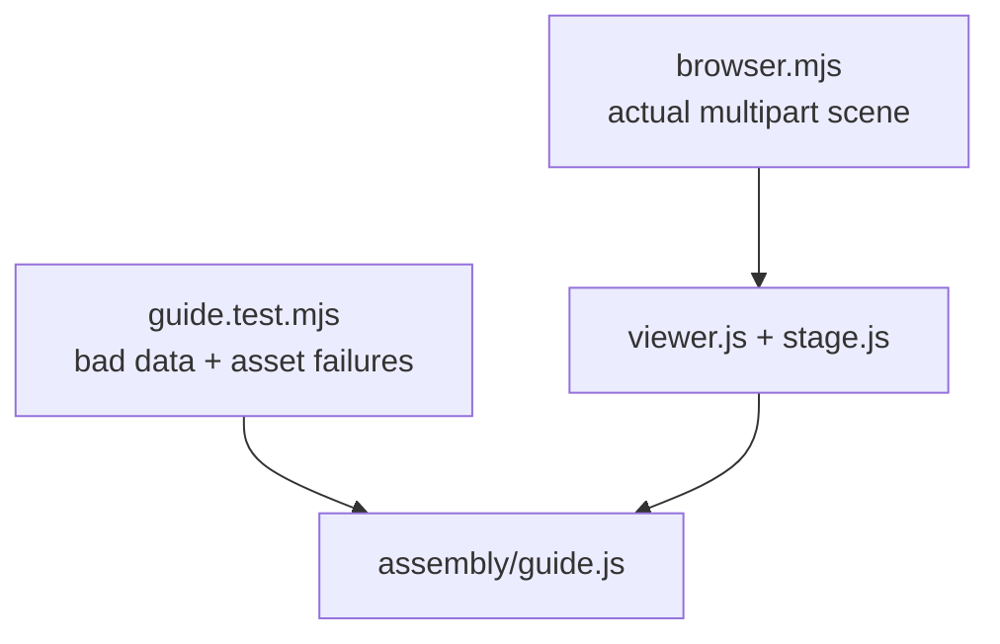

# Assembly guide tests

Strict data, reversible states and real multipart rendering for the optional [guide](../../../software/cadagent/webkit/assembly/README.md).

| File | Coverage |
|---|---|
| `__init__.py` | Empty test-package marker |
| `guide.test.mjs` | Pure validator/controller and bounded request counterexamples |
| `playback.test.mjs` | Explicit order, absolute authored poses, bounded timing, pause/loop/navigation and ownership rejection |
| `browser.mjs` | Real scene/material/coordinate/loading/lifecycle controls; stored/system theme contrast, phone HUD geometry, loading/errors, native toggle preservation of guide, selection, materials and camera; actual browser history restoration |
| `release-browser.mjs` | Real extracted ZIP, two frozen fixtures/WIP, pinned local runtime, no-script fallback and corrupted entry/model/mesh controls |

Run through the existing site npm scripts. Chromium uses the full pinned browser in headless mode and must demonstrate a native `pageshow.persisted` return with the same scene, guide and camera; an ordinary reload cannot satisfy that check. WebKit records whether it restored or reloaded and verifies the ready viewer in either case. See the [feature test matrix](../../../docs/practice/assembly-guide-testing.md) for pending versus verified results.

[Browser tests](../README.md)

`ASSEMBLY_PLAN_ONLY=1` runs only the eleven native serial-plan cases through the existing server and cleanup.
They cover the detailed and packed consumers, actual world-vertex witnesses, absolute seeks/reversal/reset,
mid-animation mini-button reversal, source-axis/order mutants, stale/duplicate-partition refusal and phone/reduced-motion controls.
Use an already installed Playwright runtime via `PLAYWRIGHT_BROWSERS_PATH`; no dependency install is required.
