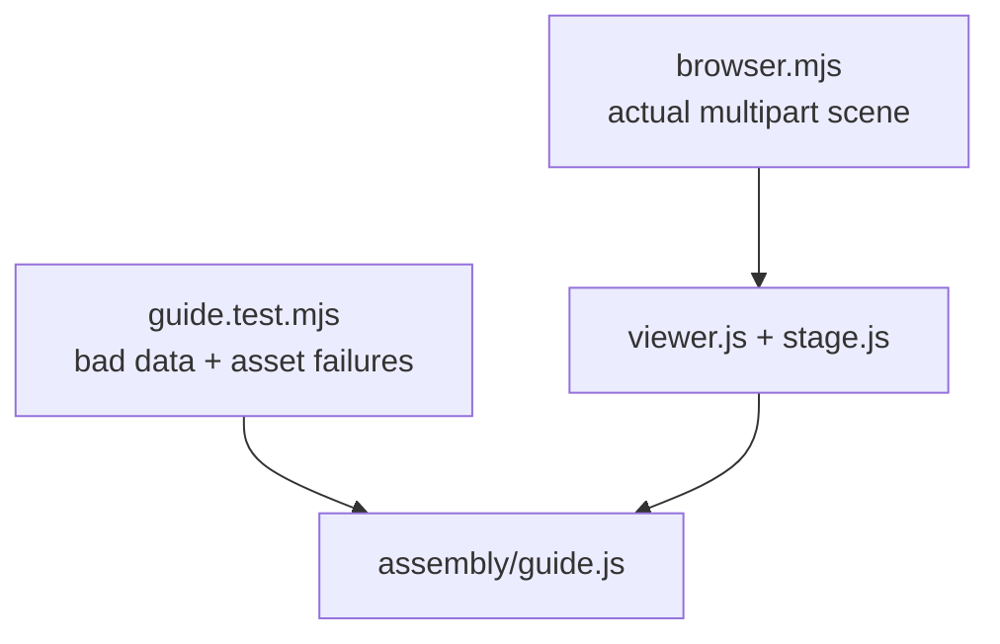

# Assembly guide tests

Strict data, reversible states and real multipart rendering for the optional [guide](../../../software/cadagent/webkit/assembly/README.md).

| File | Coverage |
|---|---|
| `__init__.py` | Empty test-package marker |
| `guide.test.mjs` | Pure validator/controller and bounded request counterexamples |
| `browser.mjs` | Real scene/material/coordinate/loading/lifecycle controls in each browser engine |

Run through the existing site npm scripts. See the [feature test matrix](../../../docs/practice/assembly-guide-testing.md) for pending versus verified results.

[Browser tests](../README.md)
