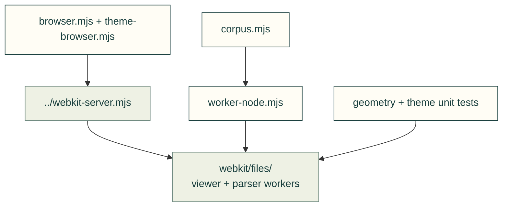

# Original CAD file tests

Tests for the reusable [file viewer](../../../software/cadagent/webkit/files/README.md). Geometry and theme tests run in Node; the browser suite loads real STL, STEP and 3MF fixtures in Chromium and WebKit.

| File | Coverage |
|---|---|
| `browser.mjs` | Real originals, dimensions, loading, worker cancellation, malformed data, retry, camera input and phone layout. |
| `theme-browser.mjs` | Shared stored/system themes, explicit query overrides, delayed-import cross-tab changes, contrast, keyboard recovery controls and scene preservation; imported by the browser suite. |
| `geometry.test.mjs` | URL boundaries, mesh normalisation and model/STL validation. |
| `theme.test.mjs` | Scoped palette configuration and malformed updates. |
| `corpus.mjs` | Optional bounded run over an already downloaded original-file manifest. |
| `worker-node.mjs` | Runs the actual shipped parser workers in Node for corpus and vendor checks. |

Run `npm --prefix tools/site run test:webkit-unit` for unit tests and `npm --prefix tools/site run test:file-viewer` for real browser checks. Set `PLAYWRIGHT_BROWSER=webkit` for the second engine; CI runs both. Browser screenshots and measured JSON go to `TEST_OUTPUT` (default `/tmp/cad-agent-file-viewer`). The [workflow guide](../../../docs/practice/file-viewer.md) documents the optional corpus run; those parser results do not replace visual checks.

[Browser tests](../README.md) · [Shared original fixtures](../../fixtures/file-viewer/README.md)
