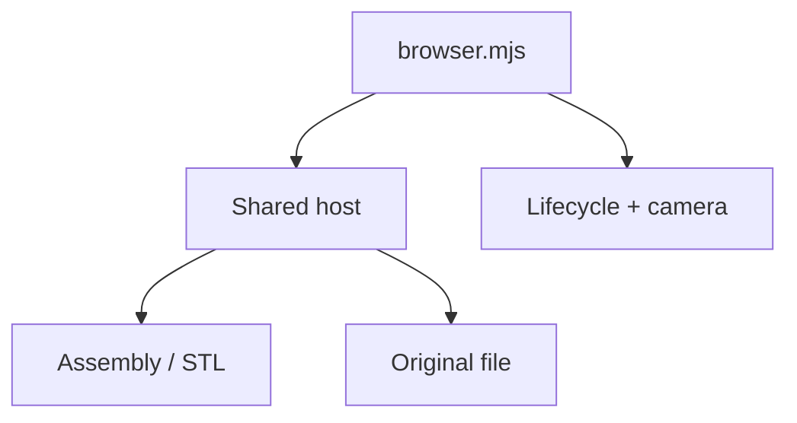

# Contained viewer tests

Real browser checks for the shared [viewer host](../../../software/cadagent/webkit/host/README.md)
and its ordinary assembly/STL and original-file adapters. The fixture uses explicit
small STL geometry and the existing STEP worker; it does not require a CAD kernel.

| File | Coverage |
| --- | --- |
| [__init__.py](__init__.py) | Empty test-package marker |
| [browser.mjs](browser.mjs) | Two real sibling viewers, scoped CSS/status, keyboard/pointer isolation, camera-preserving resize, selection, view-state validation, aborted fetch/worker mounts, partial failure, late handles and GPU/worker cleanup |

Run `node tests/webkit/host/browser.mjs` from the repository root after installing
the site npm dependencies and browser runtimes. `PLAYWRIGHT_BROWSER=webkit` selects
WebKit; otherwise the suite uses Chromium. `PLAYWRIGHT_CHANNEL=chromium` selects
the installed Playwright Chromium. A local `CHROMIUM_EXECUTABLE` may point to an
existing browser executable; it never changes the WebKit run. `TEST_OUTPUT`
selects the report/screenshot directory (default `/tmp/cad-agent-contained-viewers`).

The suite checks live resources and public adapter behavior. It does not establish
physical-model accuracy, cross-artifact identity or offline packaging, which have
separate owners and acceptance gates.

[Browser test map](../README.md)
