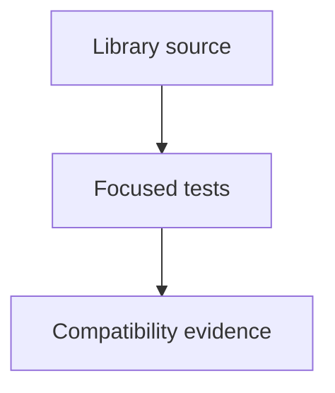

# tests/webkit/scada

SCADA regression fixtures and tests; source packages remain independently usable.

| File or folder | Purpose |
| --- | --- |
| [dependencies.mjs](dependencies.mjs) | Resolve DOM/bundler development dependencies from the tooling manifest. |
| [external-adapter-render.test.mjs](external-adapter-render.test.mjs) | Render external telemetry and mount direct circuit-model adapters to verify units, validity, read-only controls and shared session lifetime. |
| [explorer/](explorer/README.md) | Explorer search, audio, selection and wastewater integration checks. |
| [sim/](sim/README.md) | Equations, conservation, providers, external adapters and scenario generation. |
| [ui/](ui/README.md) | Portable exports, artwork, discovery, camera, viewer and workspace behavior. |

[Runtime library map](../../../software/cadagent/webkit/scada/README.md) · [Parent map](../README.md)

Run `npm --prefix tools/webkit/scada test` from the repository root. UI DOM tests use the tooling manifest through [dependencies.mjs](dependencies.mjs); model tests use only Node and the headless source. Browser checks live with the owning [SCADA tools](../../../tools/webkit/scada/README.md).
