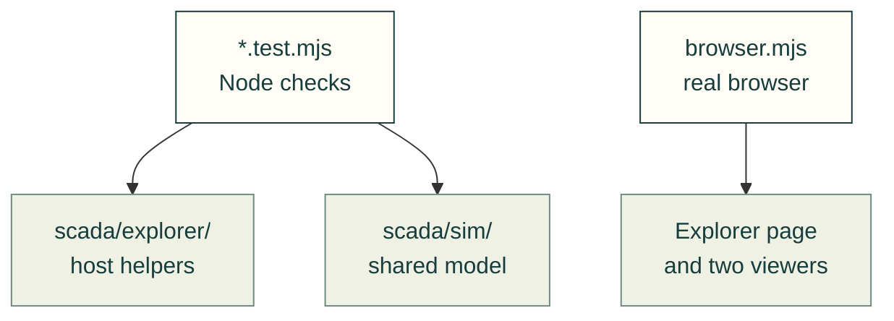

# SCADA Explorer tests

Tests for the target-owned simulation host, current-state audio and wastewater example.



| File | Contract checked |
| --- | --- |
| [audio.test.mjs](audio.test.mjs) | One opt-in audio context, alarm acknowledgement, mute/pause/hidden behavior and disposal |
| [search.test.mjs](search.test.mjs) | Search aliases, independent facets and component discovery |
| [selection.test.mjs](selection.test.mjs) | Scenario/type/variant identity and explicit fallback |
| [wastewater.test.mjs](wastewater.test.mjs) | Connected pump/valve/generator faults, repair, readonly adapter, overload and deterministic snapshot replay |
| [browser.mjs](browser.mjs) | Real controls, independent views, direct v2 read-only command capability, observer lifetime, sound, imports and contained viewport behavior |

Run the Node checks from the repository root:

```sh
node --test tests/webkit/scada/explorer/*.test.mjs
```

The browser harness uses the existing site-owned Playwright installation and
supports the repository's Chromium/WebKit selection. Its receipt records the
actual source hashes and browser checks; a Node pass is not a browser result.

```sh
npm ci --prefix tools/site
node tests/webkit/scada/explorer/browser.mjs
PLAYWRIGHT_BROWSER=webkit node tests/webkit/scada/explorer/browser.mjs
```

Use `PLAYWRIGHT_EXECUTABLE_PATH` for a locally installed Chromium, or
`PLAYWRIGHT_CHANNEL=chromium` for Playwright's pinned Chromium. `TEST_OUTPUT`
selects the scratch screenshot/receipt directory (default
`/tmp/cad-agent-scada-explorer`). To test the built website's directory redirects
and module serving, set `SCADA_BASE_URL` to its preview origin. The default
serves the canonical toolkit files through the shared test-only HTTP server.

The fault test downloads the actual browser session and rehydrates that export
to check connected load power; it does not reach into a hidden page model.
The direct v2 adapter case mounts a separate public model/viewer consumer in the
browser to verify native disabled controls and a borrowed session's lifetime.
Screenshots cover both control-room views, generator failure, readonly observer,
editable v2 assumptions, narrow diagrams, faults and the narrow observer.

[SCADA tests](../README.md) · [Explorer source](../../../../software/cadagent/webkit/scada/explorer/README.md)
