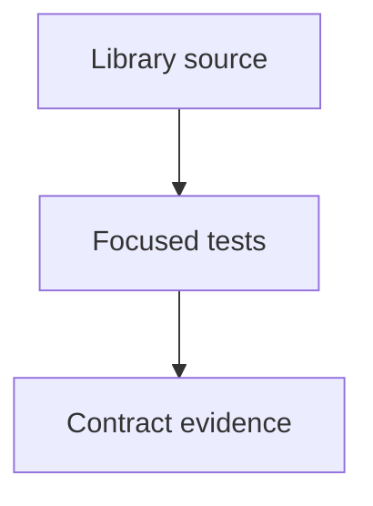

# tests/webkit/scada/sim

SCADA regression fixtures and tests; source packages remain independently usable.

| File or folder | Purpose |
| --- | --- |
| [equation-examples.test.mjs](equation-examples.test.mjs) | Actual provider swaps alter flow/power and retain motor-budget constraints. |
| [equation-physics.test.mjs](equation-physics.test.mjs) | Independent analytic pump, motor and heater reference points in SI units. |
| [equation-providers-v1.test.mjs](equation-providers-v1.test.mjs) | Version 1 equation hooks change core allocation while preserving hard gates. |
| [equation-providers-v2.test.mjs](equation-providers-v2.test.mjs) | Version 2 providers participate in circuit allocation, energy and transport. |
| [equation-runtime.test.mjs](equation-runtime.test.mjs) | Provider identity, schemas, units, selector precedence, state and replay. |
| [external-adapter.test.mjs](external-adapter.test.mjs) | External telemetry units, validity, commands and session authority. |
| [scenarios/](scenarios/README.md) | Catalog and agriculture scenario integration tests. |
| [Baseline fixtures](../../../fixtures/scada/README.md) | Frozen original model checkpoints and provenance. |
| [metadata.test.mjs](metadata.test.mjs) | Deterministic metadata and read-only stale/missing output checks. |
| [package.test.mjs](package.test.mjs) | Complete MIT terms, preserved source identity and the actual offline-installed simulation package. |
| [rack-oven.test.mjs](rack-oven.test.mjs) | Electric rack-oven heating, retained energy and switching isolation. |
| [scada-circuit-conservation.test.mjs](scada-circuit-conservation.test.mjs) | Material/energy conservation, reversible pumping and thermal transport. |
| [scada-sim-v2.test.mjs](scada-sim-v2.test.mjs) | All base/variant models, finite stores, circuits, command and restore contracts. |
| [scada-sim.test.mjs](scada-sim.test.mjs) | Version 1 valves, faults, resource limits, session state and editable parameters. |
| [scenario-docs.test.mjs](scenario-docs.test.mjs) | Deterministic scenario maps, safe paths and nonmutating freshness checks. |
| [topologies.test.mjs](topologies.test.mjs) | Routed equipment identities, geometry validation and SVG generation. |
| [v2-presentation-semantics.test.mjs](v2-presentation-semantics.test.mjs) | Transfer selection, protection decisions and observer validity match model state. |

[Runtime library map](../../../../software/cadagent/webkit/scada/README.md) · [Parent map](../README.md)

Run this group from the repository root: `node --test --test-concurrency=2 tests/webkit/scada/sim/*.test.mjs`. Install development dependencies first with `npm ci --ignore-scripts --prefix tools/webkit/scada`.
