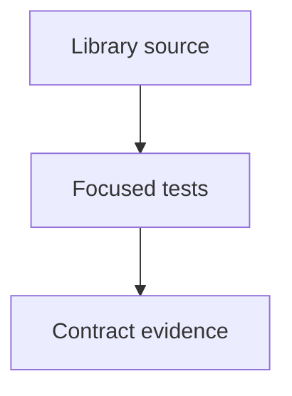

# tests/webkit/scada/sim/scenarios

SCADA regression fixtures and tests; source packages remain independently usable.

| File or folder | Purpose |
| --- | --- |
| [scada-agriculture-scenarios.test.mjs](scada-agriculture-scenarios.test.mjs) | Agriculture resource conservation, branch isolation and observation identity. |
| [scada-scenarios.test.mjs](scada-scenarios.test.mjs) | Complete catalog coverage, runnable definitions, shared views and commands. |

[Runtime library map](../../../../../software/cadagent/webkit/scada/README.md) · [Parent map](../README.md)

Run this group from the repository root: `node --test --test-concurrency=2 tests/webkit/scada/sim/scenarios/*.test.mjs`. Install development dependencies first with `npm ci --prefix tools/webkit/scada`.
