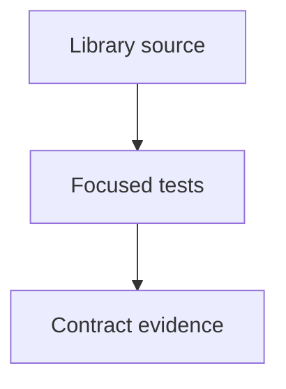

# tests/webkit/scada/ui

SCADA regression fixtures and tests; source packages remain independently usable.

| File or folder | Purpose |
| --- | --- |
| [architecture.test.mjs](architecture.test.mjs) | Isolated contract/discovery import graphs exclude artwork, controllers and host code. |
| [gallery.test.mjs](gallery.test.mjs) | CSS export fidelity, selector scoping, animation rules and gallery inventory. |
| [metadata.test.mjs](metadata.test.mjs) | Deterministic metadata and read-only stale/missing output checks. |
| [package-runtime.test.mjs](package-runtime.test.mjs) | Offline consumer renders every type/variant without starting IO or a model. |
| [package.test.mjs](package.test.mjs) | Real npm tarball exports and complete offline stylesheet dependency closure. |
| [scada-agriculture-art.test.mjs](scada-agriculture-art.test.mjs) | Vent hinges, nutrient channels, growing media and agriculture motion states. |
| [scada-camera.test.mjs](scada-camera.test.mjs) | Fit, pointer-anchored zoom, pan bounds and scroll-free viewport geometry. |
| [scada-catalog.test.mjs](scada-catalog.test.mjs) | Deterministic type/variant discovery, capabilities and safe query contracts. |
| [scada-components.test.mjs](scada-components.test.mjs) | Typed controls, ports, normalization, escaping and instance-local SVG identities. |
| [scada-fault-semantics.test.mjs](scada-fault-semantics.test.mjs) | Power loss, unavailable observations and visible independent damage cues. |
| [scada-general-art.test.mjs](scada-general-art.test.mjs) | Separator phases, material inventory, direction and pumping artwork. |
| [scada-industrial-art.test.mjs](scada-industrial-art.test.mjs) | Machine geometry, bounded speed/inventory and isolated fault overlays. |
| [scada-nuclear-art.test.mjs](scada-nuclear-art.test.mjs) | Separate heat, circulation, control and residual-incident visual layers. |
| [scada-protection-art.test.mjs](scada-protection-art.test.mjs) | Current-transformer topology and relay observation/trip semantics. |
| [scada-system.test.mjs](scada-system.test.mjs) | Versioned graph normalization, shared identities, ports and typed bindings. |
| [scada-viewer.test.mjs](scada-viewer.test.mjs) | Adapter commands, inspectors, selection, geometry and lifecycle cleanup. |
| [scada-workspace.test.mjs](scada-workspace.test.mjs) | Scoped dialogs, focus, native/fallback events and multi-workspace teardown. |

[Runtime library map](../../../../software/cadagent/webkit/scada/README.md) · [Parent map](../README.md)

Run this group from the repository root: `node --test --test-concurrency=2 tests/webkit/scada/ui/*.test.mjs`. Install development dependencies first with `npm ci --prefix tools/webkit/scada`.
